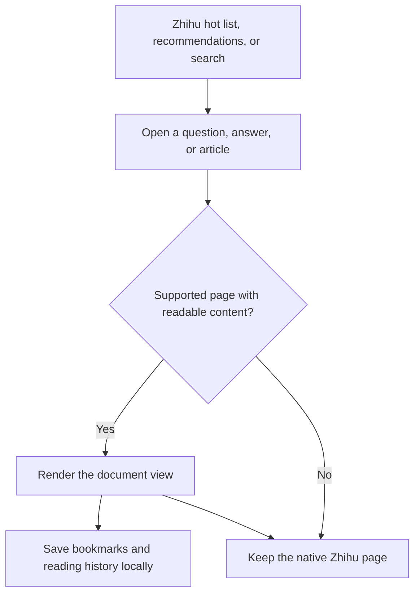

# Zhihu Doc Reader

[简体中文](README_CN.md) · [Product Definition (PDT v1.2, Chinese)](docs/PDT-V1.2.md)

Zhihu Doc Reader is a Tampermonkey userscript planned for Chrome and Microsoft Edge. It presents Zhihu answers and articles in a document-style reading view. Readers discover content through Zhihu's own pages and can save bookmarks and reading history in their browser.

**Project status**. PDT v1.2 is the development baseline. M00-A, M00-B, and M00-UI are ready to start. Implementation begins after all three pass and the project owner approves the results.

## What readers can do

| Goal | Planned feature |
| --- | --- |
| Find something to read | Browse Zhihu's hot list, native recommendations, and keyword search results |
| Focus on an answer or article | Read its text, images, and rich content in a document-style view with a link to the original |
| Keep reading | Move to the previous or next item and switch between accessible answers |
| Return to something later | Keep bookmarks, history, and reading preferences in local browser storage |
| Return to Zhihu | Switch from the reading view to the native page |

## How it works

The script reads content already loaded by Zhihu and respects the permissions of the current session. After M00 verification, question pages can use the upstream Answer Feed adapter to load more answers on demand. If that adapter is unavailable, the reader uses the answers already rendered on the page.

| Layer | Planned implementation |
| --- | --- |
| Upstream | `connectedGraph/zhihu-immersive-reader` tag `v5.1.6`, commit `942e8e5` |
| Runtime | Tampermonkey 5.3+, vanilla JavaScript, and CSS |
| View and data | URL routing, page-change observation, and sanitized rich text |
| Storage | Tampermonkey GM Storage for bookmarks, history, and preferences |
| Build and verification | Node.js bundles a single `.user.js` file. Playwright supports browser verification. |

Upstream builds with `node build.js` and produces `dist/bundle.user.js`. M00-A checks the build and reuse plan for this project. DOMPurify and Lucide are candidates for review during M00. [Upstream v5.1.6](https://github.com/connectedGraph/zhihu-immersive-reader/tree/v5.1.6) · [Upstream MIT license](https://github.com/connectedGraph/zhihu-immersive-reader/blob/v5.1.6/LICENSE)

## Development sequence

| Stage | Work |
| --- | --- |
| M00-A | Verify the upstream source, license, permissions, and build |
| M00-B | Verify Zhihu navigation, content sources, and fallback behavior in Chrome and Edge |
| M00-UI | Record document editor layout and interaction references, then prepare screenshots, `docs/design/UI-SPEC.md`, and a CSS variable table |
| M00 approval | Review the three verification results and obtain project owner approval |
| M01–M03 | Set up the codebase, build the reading view, and implement the P0 discovery and navigation flow |
| M04–M05 | Add P1 features including local collections, history, and settings. Verify P0 and P1 in both supported browsers before releasing V1.0. |

M00-UI uses Feishu Docs as a reference for reading layout. Record computed styles, screenshots, and interaction observations alongside the browser, viewport, and date. Measure default, wide, and full-width layouts separately. The proposed 800 px reading width is pending verification.
