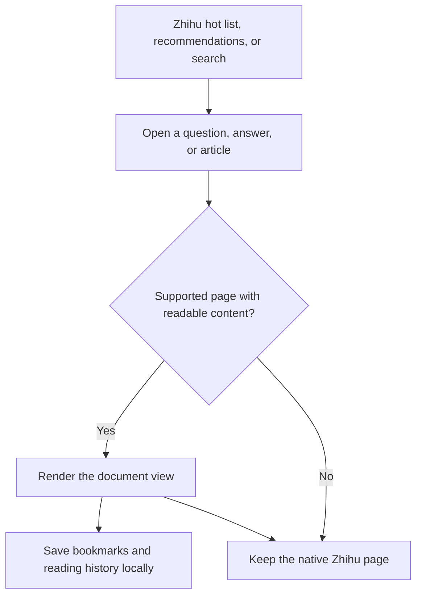

# Zhihu Doc Reader

[简体中文](README_CN.md) · [Product Definition (PDT v1.3, Chinese)](docs/PDT-V1.3.md) · [Roadmap (Chinese)](docs/ROADMAP.md)

Zhihu Doc Reader is a Tampermonkey userscript planned for Chrome and Microsoft Edge. It presents Zhihu answers and articles in a document-style reading view. Readers discover content through Zhihu's own pages and can save bookmarks and reading history in their browser.

**Project status.** M02 implements the document layout, safe rich text, and section outline for already rendered Zhihu answers and articles. Native list routes offer a labelled preview. Joint M01/M02 acceptance on live Zhihu remains blocked. Gate 01-V awaits owner confirmation and M03–M05 remain locked. [M02 validation (Chinese)](docs/M02-VALIDATION.md)

## What readers can do

| Goal | Planned feature |
| --- | --- |
| Find something to read | Browse Zhihu's hot list, native recommendations, and keyword search results |
| Focus on an answer or article | Read its text, images, and rich content in a document-style view with a link to the original |
| Keep reading | Move to the previous or next item and switch between accessible answers |
| Return to something later | Keep bookmarks, history, and reading preferences in local browser storage |
| Return to Zhihu | Switch from the reading view to the native page |

## How it works

The script reads content that Zhihu has already rendered for the current session. Readers use Zhihu's native controls to load more answers. The planned reading queue normalizes and deduplicates up to 100 items from that rendered content.

| Layer | Planned implementation |
| --- | --- |
| Upstream | `connectedGraph/zhihu-immersive-reader` tag `v5.1.6`, commit `942e8e5` |
| Runtime | Tampermonkey 5.3+, vanilla JavaScript, and CSS |
| View and data | URL routing, page-change observation, and sanitized rich text |
| Storage | Tampermonkey GM Storage for bookmarks, history, and preferences |
| Build and verification | Node.js bundles a single `.user.js` file. Playwright supports browser verification. |

## Build the development snapshot

Run `node build.js` with Node.js 22 or newer to generate [dist/bundle.user.js](dist/bundle.user.js). Run `npm test` for the unit and static safety checks. The bundled userscript includes the upstream MIT notice. [License](LICENSE) · [Upstream lock (Chinese)](docs/UPSTREAM-LOCK.md)

## Development roadmap

| Stage | Planned outcome |
| --- | --- |
| M00 | Gate 01-T requires the upstream and Zhihu verification plus owner approval. Gate 01-V follows validation of the reader's own interface. |
| M01 | Set up the codebase, remove upstream AI features, and make reader mode reversible. |
| M02 | Build the document layout and render accessible answers and articles safely. |
| M03 | Implement the hot list, recommendations, search, and continuous reading. Gate 02 produces the V0.1 internal build after P0 verification. |
| M04 | Add bookmarks, reading history, preferences, keyboard shortcuts, and the following feed for the V0.2 feature-complete candidate. |
| M05 | Verify the 28 acceptance cases, UI reference, Chrome and Edge compatibility, and CI. Gate 03 leads to the V1.0 release as a single `.user.js` file. |

`main` holds reviewed documentation and validated milestones. Ongoing module work goes into `dev`. [Tasks and acceptance criteria (Chinese)](docs/ROADMAP.md)

The owner-approved design starts with a 768 px default reading width. Design tokens supply values to separate layout, typography, and component stylesheets. The reader's own rendering and interaction provide evidence for Gate 01-V. [Initial visual specification (Chinese)](docs/design/UI-SPEC.md)
