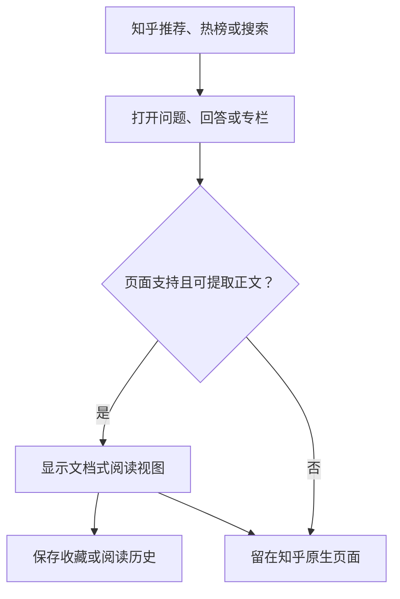

# 知乎文档阅读器 · Zhihu Doc Reader

面向 Chrome 和 Edge 的知乎沉浸阅读用户脚本。用户照常在知乎看推荐、热榜或搜索，打开问题、回答或专栏后，可以进入文档式阅读视图，并把感兴趣的条目保存在当前浏览器。

**项目状态**　PDT v1.2 设计阶段，下一步是 M00 验证。安装包随 M04–M05 验收交付。

## 首版使用场景

| 用户想做的事 | 计划提供的能力 |
| --- | --- |
| 浏览热门或推荐内容 | 沿用知乎的推荐、热榜与搜索入口，按链接进入原帖 |
| 专心读一篇回答或文章 | 将已验证的正文转为文档式阅读视图，保留标题、作者和原文链接 |
| 稍后接着读 | 在当前浏览器记录本地收藏和阅读历史 |
| 回到知乎原生页面 | 随时退出阅读视图。页面结构发生变化时，原生页面仍可使用 |

首版在 Chrome / Edge 的 Tampermonkey 中运行。飞书文档的正文宽度、标题层级和目录交互提供设计参考，阅读器使用自己的视觉样式。用户访问的是知乎网页，收藏与历史由脚本保存在本地。

## 用户操作与数据链路

1. **内容入口**　用户从知乎原生页面发现内容。M00-B 在真实页面核验推荐、热榜、搜索、问题与回答、专栏的取数来源和页面变化。
2. **正文与阅读**　脚本识别当前页面，将已验证可读的正文交给阅读视图。计划使用 DOMPurify 清理要插入视图的 HTML，保留原文入口。
3. **本地状态**　Tampermonkey 的 GM Storage 保存收藏、历史和用户设置。浏览器里的知乎登录状态仍由知乎管理。

## 实现方案

| 层 | 计划采用 |
| --- | --- |
| 阅读底库 | `connectedGraph/zhihu-immersive-reader` 的 `v5.1.6`，已核对提交 `942e8e5` |
| 运行与界面 | Tampermonkey、原生 JavaScript 和 CSS，按需使用 DOMPurify 与 Lucide |
| 浏览器存储 | GM Storage |
| 开发与交付 | Node.js 构建单文件 userscript，Playwright 用于浏览器验收 |
| 视觉参考 | 飞书文档的排版与阅读交互，Semi Design 的组件规范 |

首版采用独立的本地设计，覆盖知乎阅读与本地整理。上游项目的构建入口为 `node build.js`，输出 `dist/bundle.user.js`。本项目会在 M00-A 验证复用方式，随后提供自己的构建与安装说明。 [上游源码 v5.1.6](https://github.com/connectedGraph/zhihu-immersive-reader/tree/v5.1.6) · [上游 MIT 许可证](https://github.com/connectedGraph/zhihu-immersive-reader/blob/v5.1.6/LICENSE)

## 开工顺序

| 阶段 | 工作内容 | 完成依据 |
| --- | --- | --- |
| M00-A | 审计上游源码、构建入口、权限与可复用模块 | 记录锁定版本、上游构建结果和拟复用范围 |
| M00-B | 在真实知乎页面验证导航、正文提取、登录状态和降级行为 | 留存各入口的可复现验证记录 |
| M00-UI | 从用户有权访问的飞书个人文档实测排版与交互 | 三张参考截图、`docs/design/UI-SPEC.md` 和 CSS 变量表 |
| M00 Gate | 汇总三个验证结果，确认实现边界 | 通过后进入 M01–M03 |
| M01–M03 | 实现原生入口衔接、文档式阅读、本地收藏与历史 | 跑通页面打开、进入阅读、保存与返回的主流程 |
| M04–M05 | 在 Chrome 和 Edge 验证页面行为、存储恢复和脚本安装 | 两个浏览器均可安装并复现验收用例 |

M00-UI 用 F12 的计算样式、截图与交互观察记录浏览器、窗口尺寸、日期、实测值和设计目标。默认宽度作为首版视觉参考，较宽和全宽分别记录。800 px 是待验证的设计建议。

## 开发起点

从 M00 开始记录三份验证结果，先确认上游脚本能构建、知乎目标页面能稳定提供内容，以及阅读视图该采用的尺寸与交互。验收完成后，用户将在 Chrome 或 Edge 的 Tampermonkey 中安装本项目构建出的 `.user.js` 文件，在知乎页面验证阅读与本地保存流程。
