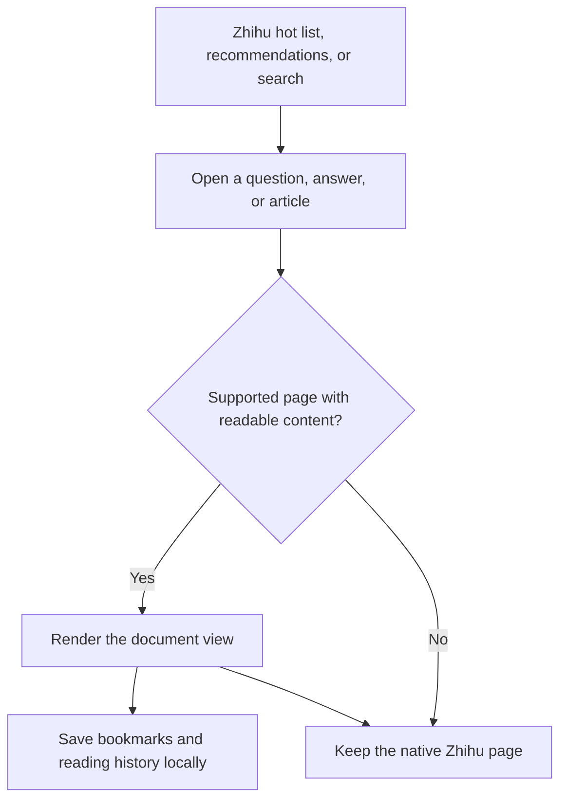

# Zhihu Doc Reader

[简体中文](README_CN.md) · [Product Definition (PDT v1.2, Chinese)](docs/PDT-V1.2.md) · [Roadmap (Chinese)](docs/ROADMAP.md)

Zhihu Doc Reader is a Tampermonkey userscript planned for Chrome and Microsoft Edge. It presents Zhihu answers and articles in a document-style reading view. Readers discover content through Zhihu's own pages and can save bookmarks and reading history in their browser.

**Project status.** Planning is complete. M00-A upstream verification is the first task. Implementation begins after M00 passes and the project owner approves the results.

## What readers can do

| Goal | Planned feature |
| --- | --- |
| Find something to read | Browse Zhihu's hot list, native recommendations, and keyword search results |
| Focus on an answer or article | Read its text, images, and rich content in a document-style view with a link to the original |
| Keep reading | Move to the previous or next item and switch between accessible answers |
| Return to something later | Keep bookmarks, history, and reading preferences in local browser storage |
| Return to Zhihu | Switch from the reading view to the native page |

## How it works

The script reads content already loaded by Zhihu and respects the permissions of the current session. After M00 verification, question pages can use the upstream Answer Feed adapter to load more answers on demand. If that adapter is unavailable, the reader uses the answers already rendered on the page. The content adapter normalizes items and removes duplicates before adding them to the reading queue of up to 100 items.

| Layer | Planned implementation |
| --- | --- |
| Upstream | `connectedGraph/zhihu-immersive-reader` tag `v5.1.6`, commit `942e8e5` |
| Runtime | Tampermonkey 5.3+, vanilla JavaScript, and CSS |
| View and data | URL routing, page-change observation, and sanitized rich text |
| Storage | Tampermonkey GM Storage for bookmarks, history, and preferences |
| Build and verification | Node.js bundles a single `.user.js` file. Playwright supports browser verification. |

Upstream builds with `node build.js` and produces `dist/bundle.user.js`. M00-A checks the build and reuse plan for this project. DOMPurify and Lucide are candidates for review during M00. [Upstream v5.1.6](https://github.com/connectedGraph/zhihu-immersive-reader/tree/v5.1.6) · [Upstream MIT license](https://github.com/connectedGraph/zhihu-immersive-reader/blob/v5.1.6/LICENSE)

## Development roadmap

| Stage | Planned outcome |
| --- | --- |
| M00 | Verify the upstream code and build, live Zhihu pages, and document layout references. Gate 01 requires all three checks and project owner approval. |
| M01 | Set up the codebase, remove upstream AI features, and make reader mode reversible. |
| M02 | Build the document layout and render accessible answers and articles safely. |
| M03 | Implement the hot list, recommendations, search, and continuous reading. Gate 02 produces the V0.1 internal build after P0 verification. |
| M04 | Add bookmarks, reading history, preferences, keyboard shortcuts, and the following feed for the V0.2 feature-complete candidate. |
| M05 | Verify the 28 acceptance cases, UI reference, Chrome and Edge compatibility, and CI. Gate 03 leads to the V1.0 release as a single `.user.js` file. |

`main` holds reviewed documentation and validated milestones. Ongoing module work goes into `dev`. The roadmap tracks 14 implementation tasks and three acceptance gates. [Tasks, acceptance criteria, and M00-A checklist (Chinese)](docs/ROADMAP.md)

M00-UI uses Feishu Docs as a reference for reading layout. Record computed styles, screenshots, and interaction observations alongside the browser, viewport, and date. Measure default, wide, and full-width layouts separately. The proposed 800 px reading width is pending verification.
