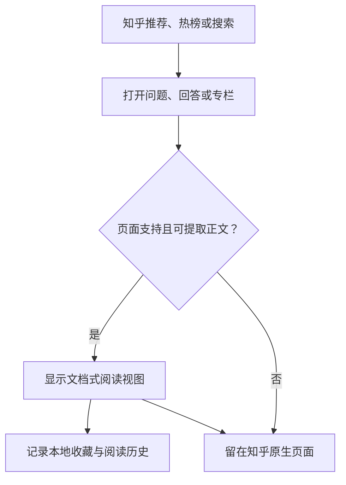

# 知乎文档阅读器 · Zhihu Doc Reader

[English](README.md) · [产品定义文档 PDT v1.2](docs/PDT-V1.2.md) · [开发路线](docs/ROADMAP.md)

面向 Chrome 和 Edge 的知乎沉浸阅读用户脚本。用户照常在知乎看推荐、热榜或搜索，打开问题、回答或专栏后，可以进入文档式阅读视图，并把感兴趣的条目保存在当前浏览器。

**项目状态**　规划已入库，从 M00-A 底库验证开始。M00 三项验证通过并经负责人确认后进入 M01–M03。

## 首版使用场景

| 用户想做的事 | 计划提供的能力 |
| --- | --- |
| 浏览热门或推荐内容 | 沿用知乎的推荐、热榜与搜索入口，按链接进入原帖 |
| 专心读一篇回答或文章 | 将已验证的正文转为文档式阅读视图，保留标题、作者和原文链接 |
| 连续阅读 | 在当前内容队列中切换上一篇、下一篇和可读回答 |
| 稍后接着读 | 在当前浏览器记录本地收藏和阅读历史 |
| 回到知乎原生页面 | 随时退出阅读视图。页面结构发生变化时，原生页面仍可使用 |

首版在 Chrome / Edge 的 Tampermonkey 5.3+ 中运行。飞书文档的正文宽度、标题层级和目录交互提供设计参考，阅读器使用自己的视觉样式。用户访问的是知乎网页，收藏与历史由脚本保存在本地。

## 用户操作与数据链路

1. **内容入口**　用户从知乎原生页面发现内容。内容适配器对已加载条目做标准化和去重，再加入最多 100 条的临时阅读队列。M00-B 在真实页面验证取数来源和降级行为。
2. **正文与阅读**　脚本识别当前页面，将已验证可读的正文交给阅读视图。优先读取已加载的页面内容。问答可在 M00 验证后复用上游 Feed 适配器，失败时回退到页面已加载回答。富文本经清洗后渲染，并保留原文入口。
3. **本地状态**　Tampermonkey 的 GM Storage 保存收藏、历史和用户设置。浏览器里的知乎登录状态仍由知乎管理。

## 实现方案

| 层 | 计划采用 |
| --- | --- |
| 阅读底库 | `connectedGraph/zhihu-immersive-reader` 的 `v5.1.6`，已核对提交 `942e8e5` |
| 运行与界面 | Tampermonkey、原生 JavaScript 和 CSS。DOMPurify 与 Lucide 是待审计的依赖建议 |
| 浏览器存储 | GM Storage |
| 开发与交付 | Node.js 构建单文件 userscript，Playwright 用于浏览器验收 |
| 视觉参考 | 飞书文档的排版与阅读交互，Semi Design 的组件规范 |

首版采用独立的本地设计，覆盖知乎阅读与本地整理。上游项目的构建入口为 `node build.js`，输出 `dist/bundle.user.js`。本项目会在 M00-A 验证复用方式，随后提供自己的构建与安装说明。 [上游源码 v5.1.6](https://github.com/connectedGraph/zhihu-immersive-reader/tree/v5.1.6) · [上游 MIT 许可证](https://github.com/connectedGraph/zhihu-immersive-reader/blob/v5.1.6/LICENSE)

## 开发路线

| 阶段 | 计划交付 |
| --- | --- |
| M00 | 核验底库与构建、知乎实机和视觉参考。三项通过且经负责人确认后通过 Gate 01。 |
| M01 | 初始化工程、剥离 AI 功能，验证阅读模式切换与恢复。 |
| M02 | 实现文档式界面与目录，安全渲染可访问的问答和专栏正文。 |
| M03 | 完成热榜、推荐、搜索与连续阅读。P0 通过 Gate 02 后交付 V0.1 内测版。 |
| M04 | 实现收藏、历史、阅读设置、快捷键和关注动态，形成 V0.2 功能完整候选版。 |
| M05 | 复测 PDT 的 28 项验收用例，完成视觉、Chrome／Edge 实机和 CI。通过 Gate 03 后发布 V1.0 单文件油猴脚本。 |

`main` 保存已确认的文档与通过验收的版本，`dev` 用于分模块开发。详细路线记录 14 项实施任务及三个验收节点。 [查看任务、验收条件与 M00-A 清单](docs/ROADMAP.md)

M00-UI 用 F12 的计算样式、截图与交互观察记录浏览器、窗口尺寸、日期、实测值和设计目标。默认宽度作为首版视觉参考，较宽和全宽分别记录。800 px 是待验证的设计建议。
