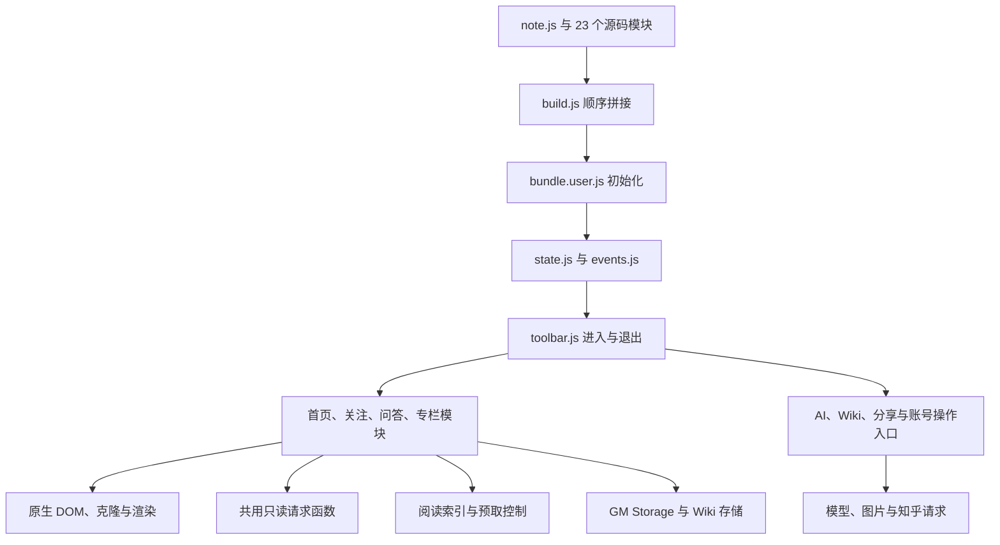

# M00 验证记录

**M00-A PASS，M00-B BLOCKED，M00-UI NOT RUN。** 原版脚本直接安装 **BLOCKED**，Gate 01 待验收。 [M00-B 执行记录](#m00-b-真实页面与数据源验证)

2026-11-26（UTC+08:00）。依据 [PDT V1.2](PDT-V1.2.md) §4、§6、§8–§10、§12.1。审计从 `dev` 的 `a2fbdd1d1d09cf1b4d0d1eae49c549c4b6ae853c` 开始，默认分支 `main` 指向相同基线。起始目录为普通工作区，已有本地 README 草稿。审计使用两棵独立、校验过的快照，用户项目快照的 Git tree 为 `5cb5f8bae4467da5231ca4eef8380741cc4a8fc4`。

## 版本、许可与构建

- 上游标签 `v5.1.6` 指向 `942e8e5422e1861da3c9315a2552312a94a97552`。35 个上游文件的 Git blob 与整树校验通过。仓内发行脚本声明 `@version 5.1.6`。MIT 版权行是 `Copyright (c) 2026 connectedGraph`。 [上游锁定及 SHA-256](UPSTREAM-LOCK.md) · [LICENSE:1](https://github.com/connectedGraph/zhihu-immersive-reader/blob/942e8e5422e1861da3c9315a2552312a94a97552/LICENSE#L1-L5) · [note.js:1](https://github.com/connectedGraph/zhihu-immersive-reader/blob/942e8e5422e1861da3c9315a2552312a94a97552/note.js#L1-L8)
- Linux x86-64／Node.js `v24.22.3`。在两个独立目录，以空白进程环境、独立网络命名空间和 Node.js 文件权限执行原始 `node build.js`。两次退出码均为 0，产物均为 713,642 字节且互相逐字节相同。原始文件、重建产物和对照产物均通过 `node --check`。 [build.js:5](https://github.com/connectedGraph/zhihu-immersive-reader/blob/942e8e5422e1861da3c9315a2552312a94a97552/build.js#L5-L18) · [build.js:48](https://github.com/connectedGraph/zhihu-immersive-reader/blob/942e8e5422e1861da3c9315a2552312a94a97552/build.js#L48-L80)
- 原始构建与标签内 710,209 字节版本的差异为 `src/wiki.js` 中 3,433 处 CRLF。将隔离副本中这一个模块换行统一为 LF 后再次用同一构建入口，产物与标签文件逐字节相同。固定 Greasy Fork 修订的正文和其余 Metadata 也一致。渠道差异局限在更新与下载指令。 [原始与对照指纹](UPSTREAM-LOCK.md#指纹)
- 标签源码目录没有包清单、锁文件、子模块或安装步骤。构建脚本读取 `note.js`，按显式顺序拼接 23 个 `src/*.js`。运行期依赖浏览器 DOM、FontFace、Canvas、Clipboard、IndexedDB 和 Tampermonkey GM API。测试范围为静态阅读、构建和语法验证，真实知乎内容接口调用为 **0**。 [build.js:5](https://github.com/connectedGraph/zhihu-immersive-reader/blob/942e8e5422e1861da3c9315a2552312a94a97552/build.js#L5-L80) · [note.js:9](https://github.com/connectedGraph/zhihu-immersive-reader/blob/942e8e5422e1861da3c9315a2552312a94a97552/note.js#L9-L30)

## 实际模块关系

`constants.js`、`styles.js`、`templates.js` 位于 IIFE 外，`state.js` 至 `events.js` 共用 IIFE 内作用域。入口用 `window._hasZhihuImmersiveSetup` 避免重复初始化。后拼入的 `wiki.js` 同名声明覆盖 `api.js` 中的 `getUserscriptXHR`、`gmFetchJSON`、`gmFetchText` 及两个文本提取辅助函数。后续拆除 Wiki 时必须保留经独立审计的读取契约，同时分离阅读记录与进度跟踪的引用。 [build.js:21](https://github.com/connectedGraph/zhihu-immersive-reader/blob/942e8e5422e1861da3c9315a2552312a94a97552/build.js#L21-L76) · [src/api.js:134](https://github.com/connectedGraph/zhihu-immersive-reader/blob/942e8e5422e1861da3c9315a2552312a94a97552/src/api.js#L134-L230) · [src/wiki.js:237](https://github.com/connectedGraph/zhihu-immersive-reader/blob/942e8e5422e1861da3c9315a2552312a94a97552/src/wiki.js#L237-L334) · [src/wiki.js:2125](https://github.com/connectedGraph/zhihu-immersive-reader/blob/942e8e5422e1861da3c9315a2552312a94a97552/src/wiki.js#L2125-L2176) · [src/toolbar.js:239](https://github.com/connectedGraph/zhihu-immersive-reader/blob/942e8e5422e1861da3c9315a2552312a94a97552/src/toolbar.js#L239-L245)

## 功能复用与剥离

| 模块或能力 | 状态 | 可复用部分、剥离入口与影响 |
| --- | --- | --- |
| `build.js`（KEEP）、`note.js`（REFACTOR） | KEEP / REFACTOR | 保留单文件构建思路，后续重新审计元数据、模块清单和更新源。 [build.js:8](https://github.com/connectedGraph/zhihu-immersive-reader/blob/942e8e5422e1861da3c9315a2552312a94a97552/build.js#L8-L46) · [note.js:9](https://github.com/connectedGraph/zhihu-immersive-reader/blob/942e8e5422e1861da3c9315a2552312a94a97552/note.js#L9-L30) |
| `state.js`、`events.js`、`toolbar.js`、`utils.js` | REFACTOR | `enterImmersive` 调用 URL 判定分派四种页面，编辑页快捷键有保护。保留 `mountLiveNode`、`restoreLiveMount` 与占位符恢复思路。退出移回文章、操作栏、评论节点，撤销样式、滚动监听及部分 Observer。脚本级监听、全局 XHR 钩子及异步请求仍需独立的清理与路由重入验证。 [src/utils.js:27](https://github.com/connectedGraph/zhihu-immersive-reader/blob/942e8e5422e1861da3c9315a2552312a94a97552/src/utils.js#L27-L49) · [src/utils.js:158](https://github.com/connectedGraph/zhihu-immersive-reader/blob/942e8e5422e1861da3c9315a2552312a94a97552/src/utils.js#L158-L191) · [src/toolbar.js:208](https://github.com/connectedGraph/zhihu-immersive-reader/blob/942e8e5422e1861da3c9315a2552312a94a97552/src/toolbar.js#L208-L245) · [src/toolbar.js:261](https://github.com/connectedGraph/zhihu-immersive-reader/blob/942e8e5422e1861da3c9315a2552312a94a97552/src/toolbar.js#L261-L325) · [src/events.js:6](https://github.com/connectedGraph/zhihu-immersive-reader/blob/942e8e5422e1861da3c9315a2552312a94a97552/src/events.js#L6-L94) |
| `constants.js`、`styles.js`、`templates.js`、`ui.js` | REFACTOR | 保留主题 CSS 变量、图片折叠、预览和控件思路。通过独立视觉基线重做界面与富文本清洗，移除远程字体和含模型凭证的设置表单。 [src/constants.js:7](https://github.com/connectedGraph/zhihu-immersive-reader/blob/942e8e5422e1861da3c9315a2552312a94a97552/src/constants.js#L7-L15) · [src/ui.js:124](https://github.com/connectedGraph/zhihu-immersive-reader/blob/942e8e5422e1861da3c9315a2552312a94a97552/src/ui.js#L124-L136) · [src/ui.js:186](https://github.com/connectedGraph/zhihu-immersive-reader/blob/942e8e5422e1861da3c9315a2552312a94a97552/src/ui.js#L186-L253) · [src/ui.js:347](https://github.com/connectedGraph/zhihu-immersive-reader/blob/942e8e5422e1861da3c9315a2552312a94a97552/src/ui.js#L347-L424) · [src/templates.js:150](https://github.com/connectedGraph/zhihu-immersive-reader/blob/942e8e5422e1861da3c9315a2552312a94a97552/src/templates.js#L150-L202) |
| `page-post.js` | KEEP | 专栏正文 DOM 和占位恢复方式可复用。账号互动、评论与自动翻译的耦合列入改造。 [src/page-post.js:173](https://github.com/connectedGraph/zhihu-immersive-reader/blob/942e8e5422e1861da3c9315a2552312a94a97552/src/page-post.js#L173-L225) · [src/page-post.js:273](https://github.com/connectedGraph/zhihu-immersive-reader/blob/942e8e5422e1861da3c9315a2552312a94a97552/src/page-post.js#L273-L309) |
| `page-home.js`、`page-follow.js`、`feed-scroll.js` | REFACTOR | 复用首页 DOM 提取、内容记录、组内导航及监听解绑思路。按 PDT 转为原生页面数据流，剥离自动补满的三组后台预取。 [src/page-home.js:387](https://github.com/connectedGraph/zhihu-immersive-reader/blob/942e8e5422e1861da3c9315a2552312a94a97552/src/page-home.js#L387-L399) · [src/page-home.js:480](https://github.com/connectedGraph/zhihu-immersive-reader/blob/942e8e5422e1861da3c9315a2552312a94a97552/src/page-home.js#L480-L501) · [src/page-follow.js:132](https://github.com/connectedGraph/zhihu-immersive-reader/blob/942e8e5422e1861da3c9315a2552312a94a97552/src/page-follow.js#L132-L160) · [src/feed-scroll.js:1](https://github.com/connectedGraph/zhihu-immersive-reader/blob/942e8e5422e1861da3c9315a2552312a94a97552/src/feed-scroll.js#L1-L97) · [src/feed-scroll.js:289](https://github.com/connectedGraph/zhihu-immersive-reader/blob/942e8e5422e1861da3c9315a2552312a94a97552/src/feed-scroll.js#L289-L308) |
| `page-question.js`（VERIFY）、`api.js` 的读取部分（REFACTOR） | VERIFY / REFACTOR | 保留已渲染回答 DOM、回答键去重、上一篇／下一篇。Feed 可用性、权限止步和后续分页均需实机验证，提取共享读取函数与模型代码的边界。 [src/page-question.js:315](https://github.com/connectedGraph/zhihu-immersive-reader/blob/942e8e5422e1861da3c9315a2552312a94a97552/src/page-question.js#L315-L351) · [src/page-question.js:748](https://github.com/connectedGraph/zhihu-immersive-reader/blob/942e8e5422e1861da3c9315a2552312a94a97552/src/page-question.js#L748-L792) · [src/api.js:173](https://github.com/connectedGraph/zhihu-immersive-reader/blob/942e8e5422e1861da3c9315a2552312a94a97552/src/api.js#L173-L217) |
| 本地主题、待读及历史 | REFACTOR | `state.js` 与 `utils.js` 优先读 GM，兼容 localStorage 迁移及远程标签页通知。待读列表经 `loadToReadList`、`saveToReadList` 保存，上限 200。历史跟踪耦合 Wiki IndexedDB 与 GM 镜像。后续使用 PDT 的 `zdr:v1:*` 键及 500／1,000／100 上限，验证知乎主站与专栏跨域一致性。 [src/state.js:44](https://github.com/connectedGraph/zhihu-immersive-reader/blob/942e8e5422e1861da3c9315a2552312a94a97552/src/state.js#L44-L103) · [src/utils.js:117](https://github.com/connectedGraph/zhihu-immersive-reader/blob/942e8e5422e1861da3c9315a2552312a94a97552/src/utils.js#L117-L142) · [src/page-home.js:823](https://github.com/connectedGraph/zhihu-immersive-reader/blob/942e8e5422e1861da3c9315a2552312a94a97552/src/page-home.js#L823-L839) · [src/wiki-store.js:267](https://github.com/connectedGraph/zhihu-immersive-reader/blob/942e8e5422e1861da3c9315a2552312a94a97552/src/wiki-store.js#L267-L330) |
| `translation.js`、`expression.js`、`radar.js`、`cache.js` | REMOVE | 剥离全文／划词 AI 翻译、表达本、摘要和 AI 阅读笔记及工具栏、快捷键和右键入口。移除翻译、表达本及笔记缓存。正文或选中文本经 `callLLM` 发往模型 Host。已保存的自动翻译配置会影响问答和专栏进入路径。 [src/translation.js:6](https://github.com/connectedGraph/zhihu-immersive-reader/blob/942e8e5422e1861da3c9315a2552312a94a97552/src/translation.js#L6-L27) · [src/radar.js:213](https://github.com/connectedGraph/zhihu-immersive-reader/blob/942e8e5422e1861da3c9315a2552312a94a97552/src/radar.js#L213-L231) · [src/radar.js:476](https://github.com/connectedGraph/zhihu-immersive-reader/blob/942e8e5422e1861da3c9315a2552312a94a97552/src/radar.js#L476-L508) · [src/events.js:76](https://github.com/connectedGraph/zhihu-immersive-reader/blob/942e8e5422e1861da3c9315a2552312a94a97552/src/events.js#L76-L94) · [src/cache.js:1](https://github.com/connectedGraph/zhihu-immersive-reader/blob/942e8e5422e1861da3c9315a2552312a94a97552/src/cache.js#L1-L100) · [src/page-question.js:935](https://github.com/connectedGraph/zhihu-immersive-reader/blob/942e8e5422e1861da3c9315a2552312a94a97552/src/page-question.js#L935-L946) |
| `api-profiles.js`、`api.js` 的 LLM／Embedding | REMOVE | 清除 Host／Key／Model 表单、配置组切换和连通性测试，移除 Chat Completions、Embedding 请求及授权头。Key 以配置 JSON 存于 GM 和站点 localStorage。同步移除默认模型地址和相应跨域授权。 [src/api-profiles.js:12](https://github.com/connectedGraph/zhihu-immersive-reader/blob/942e8e5422e1861da3c9315a2552312a94a97552/src/api-profiles.js#L12-L51) · [src/api.js:1](https://github.com/connectedGraph/zhihu-immersive-reader/blob/942e8e5422e1861da3c9315a2552312a94a97552/src/api.js#L1-L113) · [src/api.js:233](https://github.com/connectedGraph/zhihu-immersive-reader/blob/942e8e5422e1861da3c9315a2552312a94a97552/src/api.js#L233-L294) · [src/ui.js:810](https://github.com/connectedGraph/zhihu-immersive-reader/blob/942e8e5422e1861da3c9315a2552312a94a97552/src/ui.js#L810-L833) · [src/utils.js:117](https://github.com/connectedGraph/zhihu-immersive-reader/blob/942e8e5422e1861da3c9315a2552312a94a97552/src/utils.js#L117-L142) |
| `wiki.js`、`wiki-store.js` | REMOVE | 从 `startWikiRun` 剥离推荐批采、跨域全文抓取、LLM 结构化、综合报告与语义搜索。移除 Wiki 历史、运行日志、卡片、向量、标签和 IndexedDB 库。通用读取与浏览历史先解除耦合。 [src/wiki.js:404](https://github.com/connectedGraph/zhihu-immersive-reader/blob/942e8e5422e1861da3c9315a2552312a94a97552/src/wiki.js#L404-L423) · [src/wiki.js:964](https://github.com/connectedGraph/zhihu-immersive-reader/blob/942e8e5422e1861da3c9315a2552312a94a97552/src/wiki.js#L964-L980) · [src/wiki.js:1345](https://github.com/connectedGraph/zhihu-immersive-reader/blob/942e8e5422e1861da3c9315a2552312a94a97552/src/wiki.js#L1345-L1364) · [src/wiki.js:1528](https://github.com/connectedGraph/zhihu-immersive-reader/blob/942e8e5422e1861da3c9315a2552312a94a97552/src/wiki.js#L1528-L1556) · [src/wiki-store.js:5](https://github.com/connectedGraph/zhihu-immersive-reader/blob/942e8e5422e1861da3c9315a2552312a94a97552/src/wiki-store.js#L5-L55) |
| `share.js`、`utils.js` 导出入口 | REMOVE | 剥离“零损分享”、跨域图片内联、剪贴板及 SVG／PNG／WebP／HTML 导出和 Markdown 复制入口。分享走用户触发的本地导出和必要的图像 GET。 [src/share.js:368](https://github.com/connectedGraph/zhihu-immersive-reader/blob/942e8e5422e1861da3c9315a2552312a94a97552/src/share.js#L368-L413) · [src/share.js:669](https://github.com/connectedGraph/zhihu-immersive-reader/blob/942e8e5422e1861da3c9315a2552312a94a97552/src/share.js#L669-L703) · [src/utils.js:402](https://github.com/connectedGraph/zhihu-immersive-reader/blob/942e8e5422e1861da3c9315a2552312a94a97552/src/utils.js#L402-L456) |
| `zhihu-action.js` | REMOVE | 剥离账号点赞、感谢、收藏等写请求、默认收藏夹初始化和 Cookie 依赖。个人收藏走 PDT 的 GM Storage。 [src/zhihu-action.js:10](https://github.com/connectedGraph/zhihu-immersive-reader/blob/942e8e5422e1861da3c9315a2552312a94a97552/src/zhihu-action.js#L10-L95) · [src/zhihu-action.js:114](https://github.com/connectedGraph/zhihu-immersive-reader/blob/942e8e5422e1861da3c9315a2552312a94a97552/src/zhihu-action.js#L114-L188) · [src/zhihu-action.js:200](https://github.com/connectedGraph/zhihu-immersive-reader/blob/942e8e5422e1861da3c9315a2552312a94a97552/src/zhihu-action.js#L200-L225) |
| 原版直接安装 | BLOCKED | 宽权限、注入时账号请求、更新源与富文本边界存在待关闭风险。见安全审计。 |

## 数据源与降级

| 功能 | 上游实际路径 | PDT 对接与证据 |
| --- | --- | --- |
| 热榜 | 注入规则及路由分派缺少 `/hot`，源码未见热榜适配器。 | 原生热榜 DOM，失败留在原页。 [note.js:9](https://github.com/connectedGraph/zhihu-immersive-reader/blob/942e8e5422e1861da3c9315a2552312a94a97552/note.js#L9-L15) · [src/toolbar.js:208](https://github.com/connectedGraph/zhihu-immersive-reader/blob/942e8e5422e1861da3c9315a2552312a94a97552/src/toolbar.js#L208-L219) |
| 推荐 | `enterHomeImmersive` 优先恢复临时缓存，首批也可经 `collectHomeFeedItemsFromDOM` 读取已加载卡片。随后 `getHomeFeedManager` 启动 `/api/v3/feed/topstory/recommend` 预取。首批 DOM 无内容时保留原页。 | 保留原生推荐 DOM 与正常加载机制，移除默认预取。 [src/page-home.js:11](https://github.com/connectedGraph/zhihu-immersive-reader/blob/942e8e5422e1861da3c9315a2552312a94a97552/src/page-home.js#L11-L29) · [src/page-home.js:480](https://github.com/connectedGraph/zhihu-immersive-reader/blob/942e8e5422e1861da3c9315a2552312a94a97552/src/page-home.js#L480-L493) · [src/page-home.js:1035](https://github.com/connectedGraph/zhihu-immersive-reader/blob/942e8e5422e1861da3c9315a2552312a94a97552/src/page-home.js#L1035-L1095) |
| 搜索 | 注入规则及路由分派缺少 `/search`，源码未见结果适配器。 | 使用原生搜索路由及已加载结果，实测空状态、登录限制和网络错误。 [note.js:9](https://github.com/connectedGraph/zhihu-immersive-reader/blob/942e8e5422e1861da3c9315a2552312a94a97552/note.js#L9-L15) · [src/toolbar.js:208](https://github.com/connectedGraph/zhihu-immersive-reader/blob/942e8e5422e1861da3c9315a2552312a94a97552/src/toolbar.js#L208-L219) |
| 问答 | 问题页默认走 Feed，单回答入口可用当前已加载正文。首批 API 失败后读当前 DOM。API 曾成功时，后续出错上抛并留给上层处理。 | 在当前会话访问边界内验证 Adapter，否则按 PDT 的负责人确认流程评估仅 DOM 读取。 [src/page-question.js:315](https://github.com/connectedGraph/zhihu-immersive-reader/blob/942e8e5422e1861da3c9315a2552312a94a97552/src/page-question.js#L315-L352) · [src/page-question.js:915](https://github.com/connectedGraph/zhihu-immersive-reader/blob/942e8e5422e1861da3c9315a2552312a94a97552/src/page-question.js#L915-L964) |
| 专栏 | `enterPostImmersive` 从当前专栏 DOM 获得原生正文节点并移入容器，退出依靠占位符还原。 | 保留可正常访问的正文和原文入口。 [src/page-post.js:173](https://github.com/connectedGraph/zhihu-immersive-reader/blob/942e8e5422e1861da3c9315a2552312a94a97552/src/page-post.js#L173-L225) · [src/toolbar.js:261](https://github.com/connectedGraph/zhihu-immersive-reader/blob/942e8e5422e1861da3c9315a2552312a94a97552/src/toolbar.js#L261-L285) |
| 关注 | `ensureFollowDataLoaded` 恢复临时缓存或使用 `/api/v3/moments`。进入后补预取，未见已加载 DOM 数据回退。 | 单独验证原生 `/follow` DOM 和登录限制，失败留在原页。 [src/page-follow.js:132](https://github.com/connectedGraph/zhihu-immersive-reader/blob/942e8e5422e1861da3c9315a2552312a94a97552/src/page-follow.js#L132-L160) · [src/page-follow.js:650](https://github.com/connectedGraph/zhihu-immersive-reader/blob/942e8e5422e1861da3c9315a2552312a94a97552/src/page-follow.js#L650-L680) · [src/page-follow.js:720](https://github.com/connectedGraph/zhihu-immersive-reader/blob/942e8e5422e1861da3c9315a2552312a94a97552/src/page-follow.js#L720-L753) |

**问答 Feed 核对。** `getQuestionFeedsApiUrl` 以当前问题 ID 组装 GET `/api/v4/questions/{question_id}/feeds`。首批传入 `include`（内容、摘要、计数、时间、作者属性）、`limit=6`、`offset=0`、`platform=desktop`。后续沿 `paging.next`，到 `is_end` 或缺少下一页时结束。单次采集会串行请求多页以填满 6 条去重记录，默认目标 6 条时最多尝试 4 页。上游只解析下一页 URL，缺少 PDT 要求的域名、路径和问题范围校验。 [src/page-question.js:150](https://github.com/connectedGraph/zhihu-immersive-reader/blob/942e8e5422e1861da3c9315a2552312a94a97552/src/page-question.js#L150-L179) · [src/page-question.js:263](https://github.com/connectedGraph/zhihu-immersive-reader/blob/942e8e5422e1861da3c9315a2552312a94a97552/src/page-question.js#L263-L309) · [src/state.js:32](https://github.com/connectedGraph/zhihu-immersive-reader/blob/942e8e5422e1861da3c9315a2552312a94a97552/src/state.js#L32-L37)

`gmFetchJSON` 优先走 GM XHR，允许正常会话，超时 20 秒。原生 Fetch 退路也使用当前会话。此读取函数没有直接读取 Cookie，账号操作模块是另一条路径。401／403／429 与其他非 2xx 一样统一抛错，网络、超时和 JSON 解析失败分别抛错。源码没有验证码分类或跨页面停请求状态，也未见基于受限标记的专门拒绝处理。首轮失败扫描已渲染回答 DOM，不用触底加载。后续分页失败上抛，后续用户操作仍可能重新尝试。实机权限与内容可用性待核验。 [src/wiki.js:276](https://github.com/connectedGraph/zhihu-immersive-reader/blob/942e8e5422e1861da3c9315a2552312a94a97552/src/wiki.js#L276-L321) · [src/page-question.js:213](https://github.com/connectedGraph/zhihu-immersive-reader/blob/942e8e5422e1861da3c9315a2552312a94a97552/src/page-question.js#L213-L271) · [src/page-question.js:312](https://github.com/connectedGraph/zhihu-immersive-reader/blob/942e8e5422e1861da3c9315a2552312a94a97552/src/page-question.js#L312-L352) · [src/page-question.js:384](https://github.com/connectedGraph/zhihu-immersive-reader/blob/942e8e5422e1861da3c9315a2552312a94a97552/src/page-question.js#L384-L420)

## 安全与权限

| 检查项 | 实际 Metadata 或行为 |
| --- | --- |
| `@match` | 7 条，匹配 `zhihu.com`／`www.zhihu.com` 首页和 `/follow`，知乎问题子域路径及专栏 `/p/*`。协议使用通配，未限定为 HTTPS。 [note.js:9](https://github.com/connectedGraph/zhihu-immersive-reader/blob/942e8e5422e1861da3c9315a2552312a94a97552/note.js#L9-L15) |
| `@grant` | 5 条。旧／新 GM XHR 名称、GM 读写存储、存储变更监听。 [note.js:16](https://github.com/connectedGraph/zhihu-immersive-reader/blob/942e8e5422e1861da3c9315a2552312a94a97552/note.js#L16-L20) |
| `@connect` | 6 条。`api.deepseek.com`、`zhihu.com`、`www.zhihu.com`、`zhuanlan.zhihu.com`、`*.zhihu.com`、`*`。最后一项允许向用户申请更广跨域权限。 [note.js:21](https://github.com/connectedGraph/zhihu-immersive-reader/blob/942e8e5422e1861da3c9315a2552312a94a97552/note.js#L21-L26) · [Tampermonkey @connect](https://www.tampermonkey.net/documentation.php?q=connect) |
| 其他指令 | `@include`、`@exclude`、`@require`、`@resource`、`@run-at` 和 `@noframes` 缺省。Tampermonkey 缺省注入时点为 `document-idle`。Metadata 未声明 CDN 代码依赖。 [note.js:1](https://github.com/connectedGraph/zhihu-immersive-reader/blob/942e8e5422e1861da3c9315a2552312a94a97552/note.js#L1-L30) · [Tampermonkey @run-at](https://www.tampermonkey.net/documentation.php?q=run_at) |
| 更新 | GitHub 标签文件的两个 URL 指向 Greasy Fork 浮动版本，版本可随更新变化。Greasy Fork 固定修订采用 `@downloadURL none`。 [固定版本及元数据差异](UPSTREAM-LOCK.md) |

| 网络目的地 | 触发或数据 | 源码证据 |
| --- | --- | --- |
| 知乎主站及匹配子域 | 推荐、关注、问答分页和跨域原文 GET，原版初始还可能请求账号资料及收藏夹。互动按钮具备账号写操作。 | [src/page-home.js:16](https://github.com/connectedGraph/zhihu-immersive-reader/blob/942e8e5422e1861da3c9315a2552312a94a97552/src/page-home.js#L16-L27) · [src/page-follow.js:14](https://github.com/connectedGraph/zhihu-immersive-reader/blob/942e8e5422e1861da3c9315a2552312a94a97552/src/page-follow.js#L14-L24) · [src/page-question.js:161](https://github.com/connectedGraph/zhihu-immersive-reader/blob/942e8e5422e1861da3c9315a2552312a94a97552/src/page-question.js#L161-L179) · [src/wiki.js:526](https://github.com/connectedGraph/zhihu-immersive-reader/blob/942e8e5422e1861da3c9315a2552312a94a97552/src/wiki.js#L526-L548) · [src/zhihu-action.js:179](https://github.com/connectedGraph/zhihu-immersive-reader/blob/942e8e5422e1861da3c9315a2552312a94a97552/src/zhihu-action.js#L179-L225) |
| `api.deepseek.com` 及用户设置的模型 Host | 模型请求、Embedding、连通性测试。请求携带配置的授权信息，输入可含正文、笔记或其它用户选中的文本。 | [src/constants.js:111](https://github.com/connectedGraph/zhihu-immersive-reader/blob/942e8e5422e1861da3c9315a2552312a94a97552/src/constants.js#L111-L120) · [src/api.js:1](https://github.com/connectedGraph/zhihu-immersive-reader/blob/942e8e5422e1861da3c9315a2552312a94a97552/src/api.js#L1-L71) · [src/api.js:233](https://github.com/connectedGraph/zhihu-immersive-reader/blob/942e8e5422e1861da3c9315a2552312a94a97552/src/api.js#L233-L294) |
| 用户配置的字体域、内容图片及头像 URL | 字体可经 GM 请求或 Fetch 获取，文章和答案显示时会解析对应资源，分享另行获取并内联图片。头像存在知乎 CDN 默认图，来源 URL 可变。 | [src/ui.js:186](https://github.com/connectedGraph/zhihu-immersive-reader/blob/942e8e5422e1861da3c9315a2552312a94a97552/src/ui.js#L186-L253) · [src/ui.js:358](https://github.com/connectedGraph/zhihu-immersive-reader/blob/942e8e5422e1861da3c9315a2552312a94a97552/src/ui.js#L358-L408) · [src/share.js:368](https://github.com/connectedGraph/zhihu-immersive-reader/blob/942e8e5422e1861da3c9315a2552312a94a97552/src/share.js#L368-L413) · [src/wiki.js:2475](https://github.com/connectedGraph/zhihu-immersive-reader/blob/942e8e5422e1861da3c9315a2552312a94a97552/src/wiki.js#L2475-L2496) |
| `update.greasyfork.org`、`github.com` | 脚本管理器的下载及更新地址。GitHub 用于用户打开上游帮助或仓库页面。 | [note.js:7](https://github.com/connectedGraph/zhihu-immersive-reader/blob/942e8e5422e1861da3c9315a2552312a94a97552/note.js#L7-L8) · [note.js:27](https://github.com/connectedGraph/zhihu-immersive-reader/blob/942e8e5422e1861da3c9315a2552312a94a97552/note.js#L27-L30) · [src/toolbar.js:76](https://github.com/connectedGraph/zhihu-immersive-reader/blob/942e8e5422e1861da3c9315a2552312a94a97552/src/toolbar.js#L76-L82) |

- **账号与权限阻断。** `events.js` 在初始化时调用 `autoInitializeDefaultCollection`。本地缺少收藏夹 ID 时，模块尝试读取账号资料及收藏夹，并可保存默认收藏夹。写操作依赖页面 Cookie。锁定的原版同时请求 `@connect *`。以普通账号或企业浏览器直接加载存在本轮未解除的风险。 [src/events.js:89](https://github.com/connectedGraph/zhihu-immersive-reader/blob/942e8e5422e1861da3c9315a2552312a94a97552/src/events.js#L89-L95) · [src/zhihu-action.js:12](https://github.com/connectedGraph/zhihu-immersive-reader/blob/942e8e5422e1861da3c9315a2552312a94a97552/src/zhihu-action.js#L12-L95) · [src/zhihu-action.js:179](https://github.com/connectedGraph/zhihu-immersive-reader/blob/942e8e5422e1861da3c9315a2552312a94a97552/src/zhihu-action.js#L179-L225) · [note.js:21](https://github.com/connectedGraph/zhihu-immersive-reader/blob/942e8e5422e1861da3c9315a2552312a94a97552/note.js#L21-L30)
- **内容与生命周期。** `buildQuestionApiClone` 将响应正文插入 HTML，`cleanupAnswerClone` 做节点移除及图片处理，未提供完整属性和协议清洗。模型输出另有 `sanitizeLLMHTML`。静态检索未见常规 `eval`／`new Function` 或动态脚本加载，`state.js` 会覆盖 XHR 原型，退出逻辑中未见恢复。页面嵌入、滚动及原型影响待隔离验证。 [src/page-question.js:188](https://github.com/connectedGraph/zhihu-immersive-reader/blob/942e8e5422e1861da3c9315a2552312a94a97552/src/page-question.js#L188-L210) · [src/utils.js:144](https://github.com/connectedGraph/zhihu-immersive-reader/blob/942e8e5422e1861da3c9315a2552312a94a97552/src/utils.js#L144-L155) · [src/ui.js:263](https://github.com/connectedGraph/zhihu-immersive-reader/blob/942e8e5422e1861da3c9315a2552312a94a97552/src/ui.js#L263-L300) · [src/state.js:1](https://github.com/connectedGraph/zhihu-immersive-reader/blob/942e8e5422e1861da3c9315a2552312a94a97552/src/state.js#L1-L13) · [src/toolbar.js:239](https://github.com/connectedGraph/zhihu-immersive-reader/blob/942e8e5422e1861da3c9315a2552312a94a97552/src/toolbar.js#L239-L245)
- **主动流量与访问边界。** 首页、关注和 Wiki 批处理均能发起后台请求。现有只读路径未见用于取消在途 Feed 请求的统一机制。未发现明确的签名破解或付费绕过实现，实际授权状态、限制处理和重定向边界需验证。 [src/feed-scroll.js:33](https://github.com/connectedGraph/zhihu-immersive-reader/blob/942e8e5422e1861da3c9315a2552312a94a97552/src/feed-scroll.js#L33-L64) · [src/page-home.js:1089](https://github.com/connectedGraph/zhihu-immersive-reader/blob/942e8e5422e1861da3c9315a2552312a94a97552/src/page-home.js#L1089-L1095) · [src/page-follow.js:742](https://github.com/connectedGraph/zhihu-immersive-reader/blob/942e8e5422e1861da3c9315a2552312a94a97552/src/page-follow.js#L742-L750) · [src/wiki.js:1345](https://github.com/connectedGraph/zhihu-immersive-reader/blob/942e8e5422e1861da3c9315a2552312a94a97552/src/wiki.js#L1345-L1364)

## 第三方依赖初评

| 来源与版本 | 许可证 | 角色、打包及网络边界 | 建议 |
| --- | --- | --- | --- |
| [zhihu-immersive-reader v5.1.6](https://github.com/connectedGraph/zhihu-immersive-reader/tree/942e8e5422e1861da3c9315a2552312a94a97552) | MIT | 现有源码按单文件拼接，原版带账户、模型、预取、资源和更新请求。 | 锁定已核验提交及指纹。原版直接安装有阻断风险。 |
| [Semi Design v2.72.0](https://github.com/DouyinFE/semi-design/releases/tag/v2.72.0) | [MIT](https://github.com/DouyinFE/semi-design/blob/v2.72.0/LICENSE) | 视觉参考。完整 React 组件库不进入构建，运行期无 Semi 请求。 | 参考其公开设计文档，布局参数另由 M00-UI 实测。 |
| [DOMPurify 3.5.0](https://github.com/cure53/DOMPurify/releases/tag/3.5.0) | [MPL-2.0 或 Apache-2.0](https://github.com/cure53/DOMPurify/blob/3.5.0/LICENSE) | 候选浏览器 HTML 清洗库，可选构建时内联发行文件。无运行期 CDN 依赖。富文本和资源策略需单独验证。 | 候选锁定，后续核验发行物完整性、用户脚本兼容性和许可通知。 |
| [Playwright v1.65.1](https://github.com/microsoft/playwright/releases/tag/v1.65.1) | [Apache-2.0](https://github.com/microsoft/playwright/blob/v1.65.1/LICENSE) | 候选开发测试依赖，安装浏览器可产生下载，测试可使用本机 Chrome／Edge 通道。产物不包含 Playwright。 | 开发期候选。扩展权限与实机行为另验。 [浏览器文档](https://playwright.dev/docs/browsers#google-chrome--microsoft-edge) |
| [Lucide 1.79.0](https://github.com/lucide-icons/lucide/releases/tag/1.79.0) | [ISC，Feather 衍生图标为 MIT](https://lucide.dev/license) | 可选图标。需要时内联选定 SVG，避免运行期网络请求。 | 先复用已审核、适用的静态图标，新增前核对单个图标来源及声明。 |
| [Node.js](https://github.com/nodejs/node) 实测 `v24.22.3` | [MIT 与随附第三方许可](https://github.com/nodejs/node/blob/main/LICENSE) | 构建时使用 `fs`、`path`，构建在网络隔离中完成，Node.js 不打入结果。 | 保留本轮构建环境版本供复现，另核验目标 CI/本机。 |
| [Tampermonkey](https://www.tampermonkey.net/changelog.php) PDT 最低 5.3，5.5.1 为候选实测版本 | [现代扩展采用专有许可](https://github.com/Tampermonkey/tampermonkey) | 独立用户运行环境，非 userscript 打包内容。管理器的更新和扩展权限会影响实际请求。 | 按 PDT 记录 Chrome／Edge 的已安装版本和权限策略。 |

各候选版本用于评估与后续验证。运行依赖的新增、选型及锁定待负责人确认。

## 验收结果

| ID | 状态 | 证据 |
| --- | --- | --- |
| A01 | PASS | 上游仓库、Git 标签及 Greasy Fork 固定发行均已确认。 |
| A02 | PASS | 完整提交 SHA、源码树和逐文件 Git blob 已校验。 |
| A03 | PASS | 仓内发行文件已获取、计算 SHA-256。与固定发行正文、直构及 LF 对照结果完成归因。 |
| A04 | PASS | 已核验 MIT 许可及原版权行和文件指纹。 |
| A05 | PASS | 审阅 23 个源码模块，已记录实际拼接、路由、渲染、存储与生命周期。 |
| A06 | PASS | 完成复用、重构、剥离和阻断矩阵，登记共享函数耦合。 |
| A07 | PASS | 完成 Metadata、授权范围、更新地址与账号访问审计。 |
| A08 | PASS | 已识别静态外部请求路径及触发条件。 |
| A09 | PASS | 已核查现有构建依赖并初评全部候选库。 |
| A10 | PASS | 两次原始隔离构建与语法检查通过，LF 对照逐字节匹配标签产物。 |
| A11 | PASS | 完成六类来源及 Feed 失败、会话、分页和降级静态审计。 |
| A12 | PASS | 已列出 M00-B 的取证项和原版直接安装前置风险。 |

## M00-B 待验证事项

1. 取得下一轮授权后，在 Chrome 和 Edge 记录 OS、浏览器、Tampermonkey 版本、日期、URL 和访问状态。先用原生页面确认首页、关注、热榜、搜索、问答、专栏的已加载内容与可见访问限制。
2. 原版脚本的隔离验证须先明确账号数据、域名、自动更新及网络控制方案。当前宽权限、自动账号查询、XHR 修改和富文本风险限制原版直接安装。登录受限、验证码或权限状态按 PDT 停止，保留无敏感信息的证据。
3. 先以离线样本验证受限结果、后续分页失败及恢复路径。获得授权且边界可控后，再验证 Feed 的批次、只读性、下一页范围与停止行为。条件不满足时，记录仅 DOM 的验证结果并按 PDT 提请负责人确认。
4. 核对页面切换、重新进入、退出和跨域读写的可复用性。优先验证原页恢复、无重复组件、无读取站点凭证和无非预期第三方请求的证据。

本轮停在 M00-A。实机与视觉结果待对应阶段取证，Gate 01 由负责人按 PDT 验收。

## M00-B 真实页面与数据源验证

2026-11-26（UTC+08:00）。项目基线 `755730d4c52726dc75d7e19678edb4f1efe57627`，上游仍以 [UPSTREAM-LOCK.md](UPSTREAM-LOCK.md) 为准。**M00-B BLOCKED。** 已完成六路原生页面观察、只读脚本审查及 20 项离线样本验证。个人浏览器的扩展与跨域验收仍缺证。

### 环境和测试边界

| 环境 | 实际记录 |
| --- | --- |
| 执行工作区 | Debian GNU/Linux 13，Linux 6.18.57 x86-64，Node.js `v24.22.3`。目录为隔离验证目录。 |
| 云端原生观察 | 云端 Chrome 浏览器，完整版本未取得。知乎界面显示未登录。未安装验证脚本，未进行登录、扫码或验证码操作。 |
| 个人 Chrome／Edge | 未连接个人电脑。执行工作区未找到 Chrome 或 Edge 可执行文件。Chromium 系统包装脚本和 Playwright 本地浏览器均缺少可执行文件。个人浏览器版本、独立配置文件和用户脚本权限待记录。 |
| Tampermonkey | 实际版本、注入权限与跨域存储均待实机验证。离线测试使用 LinkeDOM 和 GM Storage 替身。 |

原生打开 PDT 页面只用于观察。主动真实 Feed 请求 **0 次**。原版脚本直接安装继续标记为 **BLOCKED**。云端版本页访问受浏览器 URL 策略限制，版号未取证。

### 六类原生数据源

| PDT 样本 | 云端未登录观察 | DOM 字段、动态加载与降级 | 状态 |
| --- | --- | --- | --- |
| URL01 首页推荐 | `/` 跳转 `/signin?next=%2F`。 | `#TopstoryContent .TopstoryItem` 为 0。标题、作者、摘要、原文与原生加载行为待验证，停在登录页。 | BLOCKED |
| URL02 关注动态 | `/follow` 跳转 `/signin?next=%2Ffollow`。 | 只呈现登录页，关注条目容器和字段未暴露，保留原生登录提示。 | BLOCKED |
| URL03 热榜 | 独立访问 `/hot`，跳转 `/signin?next=%2Fhot`。 | 原生排名、卡片选择器、条目和加载行为未暴露，保留原生登录提示。 | BLOCKED |
| URL04 问答 | 指定问题先进入安全验证页面，随后进入 `/signin`。 | 已渲染回答、正文、图片、原文链接和原生继续加载均待验证。停止于原生限制。 | BLOCKED |
| URL05 专栏 | [原样本](https://zhuanlan.zhihu.com/p/352503954) 可打开，页面有公开正文和登录入口。 | `article.Post-Main` 1 个，`.Post-Title` 与 `.Post-Author .AuthorInfo-name` 有可见内容。`.Post-RichText` 实测 2,041 字符、45 段、6 个标题、6 个链接、3 张已加载图片。当前地址即原文，未见独立摘要容器；滚动尝试中根滚动位置保持 0，动态加载未确认。 | PASS |
| URL06 搜索 | 独立访问关键词「阅读」，保持在原生 `/search`。页面显示搜索框和明确登录提示。 | `.Search-container` 与 `.SearchMain` 各 1 个，结果卡片 0，未显示空结果文案。标题、作者、摘要、原文链接与分页待验证。保留原生登录提示。 | BLOCKED |

访问范围为 PDT 的六条原样本。缺失的数据使用 [合成 HTML](../validation/m00-b/fixtures/native-shapes.html) 验证相应分支，线上证据保留原始访问结果。合成首页、关注、热榜及问答选择器均为候选。搜索只实证了页面外壳，专栏选择器有实际原生证据。

### 离线验证和方案选择

- [只读验证脚本](../validation/m00-b/dom-probe.user.js) 仅匹配指定知乎路径与专栏。三项授权专用于固定 GM 测试标记的读写和清理。打开原文由用户点击。正文以纯文本显示。面板挂载至独立节点，关闭时解除监听并移除。安全检查覆盖网络请求入口、Cookie、全局 XHR、远程依赖、更新指令和原始正文 HTML 注入。
- [离线测试](../validation/m00-b/offline.test.mjs) 在网络隔离下完成 **20/20 PASS**，覆盖六路合成 DOM、链接归一与类型识别、去重及队列上限、回答切换、新条目重新扫描、登录及安全限制、空搜索、缺失正文、图片失败、路由变更、重复挂载、退出恢复及 GM 替身异常。文件指纹与复现方式见 [验证目录](../validation/m00-b/README.md)。
- 推荐 **DOM-only 优先**。离线证实可从已渲染回答建立队列、查看全文文本、定位原文和切换条目。真实问答受限，实机的原生继续加载及切换待确认。能力边界是当前页面已加载且有权访问的条目，加载更多由知乎原生操作完成。规格锁定、Feed 真实请求及替代验收方式均待相应确认。

### B01–B14 验收

| ID | 验收事项 | 状态 | 证据或缺口 |
| --- | --- | --- | --- |
| B01 | 个人浏览器及扩展环境 | BLOCKED | 本地无可运行的 Chrome／Edge 实机与 Tampermonkey，个人配置版本待取证。 |
| B02 | 首页推荐数据源 | BLOCKED | 原生 URL 跳转登录页。 |
| B03 | 关注动态数据源 | BLOCKED | 原生 URL 跳转登录页。 |
| B04 | 热榜数据源 | BLOCKED | 独立访问后跳转登录页，无热榜条目。 |
| B05 | 搜索数据源 | BLOCKED | 独立访问获得搜索和登录界面，结果卡片为 0。 |
| B06 | 问答 DOM | BLOCKED | 安全验证后进入登录页，无已渲染回答。 |
| B07 | 专栏正文 DOM | PASS | 云端原生页面证实标题、作者、正文、原文地址和图片。 |
| B08 | 最小只读脚本安全检查 | PASS | 语法、Metadata、网络及渲染边界检查通过。 |
| B09 | Chrome 实机 | BLOCKED | 个人 Chrome 与 Tampermonkey 组合不可用。 |
| B10 | Edge 实机 | BLOCKED | 个人 Edge 与 Tampermonkey 组合不可用。 |
| B11 | 原生页面恢复 | NOT RUN | 离线退出及原样恢复通过，实机运行待验证。 |
| B12 | 主站／专栏跨域 GM Storage | BLOCKED | 离线存储读写和回退通过，真实跨域共享待验证。 |
| B13 | DOM-only 或 Feed 结论 | BLOCKED | DOM-only 推荐优先，离线闭环通过，实际问答闭环缺证。 |
| B14 | 登录限制及异常降级 | BLOCKED | 已观察原生登录限制并验证离线回退，实机全套待验证。 |

个人 Chrome 与 Edge 的最小取证步骤、跨域测试标记和可回填表格见 [验证目录](../validation/m00-b/README.md)。Gate 01 需要负责人确认替代原版安装的验收方式。本轮止于 M00-B，M00-UI 待授权。
