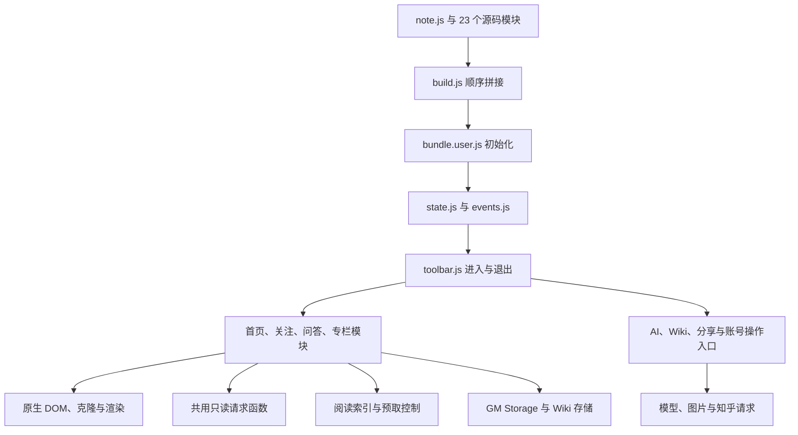

# M00 验证记录

**M00-A PASS，M00-B PASS（已结项），M00-UI-A 已完成。M00-UI-B 已授权，已取得真实编辑器 DOM 读数，正式实测待补证。** 原版脚本直接安装 **BLOCKED**，Gate 01 待验收。 [M00-B 执行记录](#m00-b-真实页面与数据源验证) · [M00-UI-A](#m00-ui-a-公开视觉研究与测量准备) · [M00-UI-B](#m00-ui-b-真实编辑器样式初测)

2026-11-26（UTC+08:00）。依据 [PDT V1.2](PDT-V1.2.md) §4、§6、§8–§10、§12.1。审计从 `dev` 的 `a2fbdd1d1d09cf1b4d0d1eae49c549c4b6ae853c` 开始，默认分支 `main` 指向相同基线。起始目录为普通工作区，已有本地 README 草稿。审计使用两棵独立、校验过的快照，用户项目快照的 Git tree 为 `5cb5f8bae4467da5231ca4eef8380741cc4a8fc4`。

## 版本、许可与构建

- 上游标签 `v5.1.6` 指向 `942e8e5422e1861da3c9315a2552312a94a97552`。35 个上游文件的 Git blob 与整树校验通过。仓内发行脚本声明 `@version 5.1.6`。MIT 版权行是 `Copyright (c) 2026 connectedGraph`。 [上游锁定及 SHA-256](UPSTREAM-LOCK.md) · [LICENSE:1](https://github.com/connectedGraph/zhihu-immersive-reader/blob/942e8e5422e1861da3c9315a2552312a94a97552/LICENSE#L1-L5) · [note.js:1](https://github.com/connectedGraph/zhihu-immersive-reader/blob/942e8e5422e1861da3c9315a2552312a94a97552/note.js#L1-L8)
- Linux x86-64／Node.js `v24.22.3`。在两个独立目录，以空白进程环境、独立网络命名空间和 Node.js 文件权限执行原始 `node build.js`。两次退出码均为 0，产物均为 713,642 字节且互相逐字节相同。原始文件、重建产物和对照产物均通过 `node --check`。 [build.js:5](https://github.com/connectedGraph/zhihu-immersive-reader/blob/942e8e5422e1861da3c9315a2552312a94a97552/build.js#L5-L18) · [build.js:48](https://github.com/connectedGraph/zhihu-immersive-reader/blob/942e8e5422e1861da3c9315a2552312a94a97552/build.js#L48-L80)
- 原始构建与标签内 710,209 字节版本的差异为 `src/wiki.js` 中 3,433 处 CRLF。将隔离副本中这一个模块换行统一为 LF 后再次用同一构建入口，产物与标签文件逐字节相同。固定 Greasy Fork 修订的正文和其余 Metadata 也一致。渠道差异局限在更新与下载指令。 [原始与对照指纹](UPSTREAM-LOCK.md#指纹)
- 标签源码目录没有包清单、锁文件、子模块或安装步骤。构建脚本读取 `note.js`，按显式顺序拼接 23 个 `src/*.js`。运行期依赖浏览器 DOM、FontFace、Canvas、Clipboard、IndexedDB 和 Tampermonkey GM API。测试范围为静态阅读、构建和语法验证，真实知乎内容接口调用为 **0**。 [build.js:5](https://github.com/connectedGraph/zhihu-immersive-reader/blob/942e8e5422e1861da3c9315a2552312a94a97552/build.js#L5-L80) · [note.js:9](https://github.com/connectedGraph/zhihu-immersive-reader/blob/942e8e5422e1861da3c9315a2552312a94a97552/note.js#L9-L30)

## 实际模块关系

`constants.js`、`styles.js`、`templates.js` 位于 IIFE 外，`state.js` 至 `events.js` 共用 IIFE 内作用域。入口用 `window._hasZhihuImmersiveSetup` 避免重复初始化。后拼入的 `wiki.js` 同名声明覆盖 `api.js` 中的 `getUserscriptXHR`、`gmFetchJSON`、`gmFetchText` 及两个文本提取辅助函数。后续拆除 Wiki 时必须保留经独立审计的读取契约，同时分离阅读记录与进度跟踪的引用。 [build.js:21](https://github.com/connectedGraph/zhihu-immersive-reader/blob/942e8e5422e1861da3c9315a2552312a94a97552/build.js#L21-L76) · [src/api.js:134](https://github.com/connectedGraph/zhihu-immersive-reader/blob/942e8e5422e1861da3c9315a2552312a94a97552/src/api.js#L134-L230) · [src/wiki.js:237](https://github.com/connectedGraph/zhihu-immersive-reader/blob/942e8e5422e1861da3c9315a2552312a94a97552/src/wiki.js#L237-L334) · [src/wiki.js:2125](https://github.com/connectedGraph/zhihu-immersive-reader/blob/942e8e5422e1861da3c9315a2552312a94a97552/src/wiki.js#L2125-L2176) · [src/toolbar.js:239](https://github.com/connectedGraph/zhihu-immersive-reader/blob/942e8e5422e1861da3c9315a2552312a94a97552/src/toolbar.js#L239-L245)

## 功能复用与剥离

| 模块或能力 | 状态 | 可复用部分、剥离入口与影响 |
| --- | --- | --- |
| `build.js`（KEEP）、`note.js`（REFACTOR） | KEEP / REFACTOR | 保留单文件构建思路，后续重新审计元数据、模块清单和更新源。 [build.js:8](https://github.com/connectedGraph/zhihu-immersive-reader/blob/942e8e5422e1861da3c9315a2552312a94a97552/build.js#L8-L46) · [note.js:9](https://github.com/connectedGraph/zhihu-immersive-reader/blob/942e8e5422e1861da3c9315a2552312a94a97552/note.js#L9-L30) |
| `state.js`、`events.js`、`toolbar.js`、`utils.js` | REFACTOR | `enterImmersive` 调用 URL 判定分派四种页面，编辑页快捷键有保护。保留 `mountLiveNode`、`restoreLiveMount` 与占位符恢复思路。退出移回文章、操作栏、评论节点，撤销样式、滚动监听及部分 Observer。脚本级监听、全局 XHR 钩子及异步请求仍需独立的清理与路由重入验证。 [src/utils.js:27](https://github.com/connectedGraph/zhihu-immersive-reader/blob/942e8e5422e1861da3c9315a2552312a94a97552/src/utils.js#L27-L49) · [src/utils.js:158](https://github.com/connectedGraph/zhihu-immersive-reader/blob/942e8e5422e1861da3c9315a2552312a94a97552/src/utils.js#L158-L191) · [src/toolbar.js:208](https://github.com/connectedGraph/zhihu-immersive-reader/blob/942e8e5422e1861da3c9315a2552312a94a97552/src/toolbar.js#L208-L245) · [src/toolbar.js:261](https://github.com/connectedGraph/zhihu-immersive-reader/blob/942e8e5422e1861da3c9315a2552312a94a97552/src/toolbar.js#L261-L325) · [src/events.js:6](https://github.com/connectedGraph/zhihu-immersive-reader/blob/942e8e5422e1861da3c9315a2552312a94a97552/src/events.js#L6-L94) |
| `constants.js`、`styles.js`、`templates.js`、`ui.js` | REFACTOR | 保留主题 CSS 变量、图片折叠、预览和控件思路。通过独立视觉基线重做界面与富文本清洗，移除远程字体和含模型凭证的设置表单。 [src/constants.js:7](https://github.com/connectedGraph/zhihu-immersive-reader/blob/942e8e5422e1861da3c9315a2552312a94a97552/src/constants.js#L7-L15) · [src/ui.js:124](https://github.com/connectedGraph/zhihu-immersive-reader/blob/942e8e5422e1861da3c9315a2552312a94a97552/src/ui.js#L124-L136) · [src/ui.js:186](https://github.com/connectedGraph/zhihu-immersive-reader/blob/942e8e5422e1861da3c9315a2552312a94a97552/src/ui.js#L186-L253) · [src/ui.js:347](https://github.com/connectedGraph/zhihu-immersive-reader/blob/942e8e5422e1861da3c9315a2552312a94a97552/src/ui.js#L347-L424) · [src/templates.js:150](https://github.com/connectedGraph/zhihu-immersive-reader/blob/942e8e5422e1861da3c9315a2552312a94a97552/src/templates.js#L150-L202) |
| `page-post.js` | KEEP | 专栏正文 DOM 和占位恢复方式可复用。账号互动、评论与自动翻译的耦合列入改造。 [src/page-post.js:173](https://github.com/connectedGraph/zhihu-immersive-reader/blob/942e8e5422e1861da3c9315a2552312a94a97552/src/page-post.js#L173-L225) · [src/page-post.js:273](https://github.com/connectedGraph/zhihu-immersive-reader/blob/942e8e5422e1861da3c9315a2552312a94a97552/src/page-post.js#L273-L309) |
| `page-home.js`、`page-follow.js`、`feed-scroll.js` | REFACTOR | 复用首页 DOM 提取、内容记录、组内导航及监听解绑思路。按 PDT 转为原生页面数据流，剥离自动补满的三组后台预取。 [src/page-home.js:387](https://github.com/connectedGraph/zhihu-immersive-reader/blob/942e8e5422e1861da3c9315a2552312a94a97552/src/page-home.js#L387-L399) · [src/page-home.js:480](https://github.com/connectedGraph/zhihu-immersive-reader/blob/942e8e5422e1861da3c9315a2552312a94a97552/src/page-home.js#L480-L501) · [src/page-follow.js:132](https://github.com/connectedGraph/zhihu-immersive-reader/blob/942e8e5422e1861da3c9315a2552312a94a97552/src/page-follow.js#L132-L160) · [src/feed-scroll.js:1](https://github.com/connectedGraph/zhihu-immersive-reader/blob/942e8e5422e1861da3c9315a2552312a94a97552/src/feed-scroll.js#L1-L97) · [src/feed-scroll.js:289](https://github.com/connectedGraph/zhihu-immersive-reader/blob/942e8e5422e1861da3c9315a2552312a94a97552/src/feed-scroll.js#L289-L308) |
| `page-question.js`（VERIFY）、`api.js` 的读取部分（REFACTOR） | VERIFY / REFACTOR | 保留已渲染回答 DOM、回答键去重、上一篇／下一篇。Feed 可用性、权限止步和后续分页均需实机验证，提取共享读取函数与模型代码的边界。 [src/page-question.js:315](https://github.com/connectedGraph/zhihu-immersive-reader/blob/942e8e5422e1861da3c9315a2552312a94a97552/src/page-question.js#L315-L351) · [src/page-question.js:748](https://github.com/connectedGraph/zhihu-immersive-reader/blob/942e8e5422e1861da3c9315a2552312a94a97552/src/page-question.js#L748-L792) · [src/api.js:173](https://github.com/connectedGraph/zhihu-immersive-reader/blob/942e8e5422e1861da3c9315a2552312a94a97552/src/api.js#L173-L217) |
| 本地主题、待读及历史 | REFACTOR | `state.js` 与 `utils.js` 优先读 GM，兼容 localStorage 迁移及远程标签页通知。待读列表经 `loadToReadList`、`saveToReadList` 保存，上限 200。历史跟踪耦合 Wiki IndexedDB 与 GM 镜像。后续使用 PDT 的 `zdr:v1:*` 键及 500／1,000／100 上限，验证知乎主站与专栏跨域一致性。 [src/state.js:44](https://github.com/connectedGraph/zhihu-immersive-reader/blob/942e8e5422e1861da3c9315a2552312a94a97552/src/state.js#L44-L103) · [src/utils.js:117](https://github.com/connectedGraph/zhihu-immersive-reader/blob/942e8e5422e1861da3c9315a2552312a94a97552/src/utils.js#L117-L142) · [src/page-home.js:823](https://github.com/connectedGraph/zhihu-immersive-reader/blob/942e8e5422e1861da3c9315a2552312a94a97552/src/page-home.js#L823-L839) · [src/wiki-store.js:267](https://github.com/connectedGraph/zhihu-immersive-reader/blob/942e8e5422e1861da3c9315a2552312a94a97552/src/wiki-store.js#L267-L330) |
| `translation.js`、`expression.js`、`radar.js`、`cache.js` | REMOVE | 剥离全文／划词 AI 翻译、表达本、摘要和 AI 阅读笔记及工具栏、快捷键和右键入口。移除翻译、表达本及笔记缓存。正文或选中文本经 `callLLM` 发往模型 Host。已保存的自动翻译配置会影响问答和专栏进入路径。 [src/translation.js:6](https://github.com/connectedGraph/zhihu-immersive-reader/blob/942e8e5422e1861da3c9315a2552312a94a97552/src/translation.js#L6-L27) · [src/radar.js:213](https://github.com/connectedGraph/zhihu-immersive-reader/blob/942e8e5422e1861da3c9315a2552312a94a97552/src/radar.js#L213-L231) · [src/radar.js:476](https://github.com/connectedGraph/zhihu-immersive-reader/blob/942e8e5422e1861da3c9315a2552312a94a97552/src/radar.js#L476-L508) · [src/events.js:76](https://github.com/connectedGraph/zhihu-immersive-reader/blob/942e8e5422e1861da3c9315a2552312a94a97552/src/events.js#L76-L94) · [src/cache.js:1](https://github.com/connectedGraph/zhihu-immersive-reader/blob/942e8e5422e1861da3c9315a2552312a94a97552/src/cache.js#L1-L100) · [src/page-question.js:935](https://github.com/connectedGraph/zhihu-immersive-reader/blob/942e8e5422e1861da3c9315a2552312a94a97552/src/page-question.js#L935-L946) |
| `api-profiles.js`、`api.js` 的 LLM／Embedding | REMOVE | 清除 Host／Key／Model 表单、配置组切换和连通性测试，移除 Chat Completions、Embedding 请求及授权头。Key 以配置 JSON 存于 GM 和站点 localStorage。同步移除默认模型地址和相应跨域授权。 [src/api-profiles.js:12](https://github.com/connectedGraph/zhihu-immersive-reader/blob/942e8e5422e1861da3c9315a2552312a94a97552/src/api-profiles.js#L12-L51) · [src/api.js:1](https://github.com/connectedGraph/zhihu-immersive-reader/blob/942e8e5422e1861da3c9315a2552312a94a97552/src/api.js#L1-L113) · [src/api.js:233](https://github.com/connectedGraph/zhihu-immersive-reader/blob/942e8e5422e1861da3c9315a2552312a94a97552/src/api.js#L233-L294) · [src/ui.js:810](https://github.com/connectedGraph/zhihu-immersive-reader/blob/942e8e5422e1861da3c9315a2552312a94a97552/src/ui.js#L810-L833) · [src/utils.js:117](https://github.com/connectedGraph/zhihu-immersive-reader/blob/942e8e5422e1861da3c9315a2552312a94a97552/src/utils.js#L117-L142) |
| `wiki.js`、`wiki-store.js` | REMOVE | 从 `startWikiRun` 剥离推荐批采、跨域全文抓取、LLM 结构化、综合报告与语义搜索。移除 Wiki 历史、运行日志、卡片、向量、标签和 IndexedDB 库。通用读取与浏览历史先解除耦合。 [src/wiki.js:404](https://github.com/connectedGraph/zhihu-immersive-reader/blob/942e8e5422e1861da3c9315a2552312a94a97552/src/wiki.js#L404-L423) · [src/wiki.js:964](https://github.com/connectedGraph/zhihu-immersive-reader/blob/942e8e5422e1861da3c9315a2552312a94a97552/src/wiki.js#L964-L980) · [src/wiki.js:1345](https://github.com/connectedGraph/zhihu-immersive-reader/blob/942e8e5422e1861da3c9315a2552312a94a97552/src/wiki.js#L1345-L1364) · [src/wiki.js:1528](https://github.com/connectedGraph/zhihu-immersive-reader/blob/942e8e5422e1861da3c9315a2552312a94a97552/src/wiki.js#L1528-L1556) · [src/wiki-store.js:5](https://github.com/connectedGraph/zhihu-immersive-reader/blob/942e8e5422e1861da3c9315a2552312a94a97552/src/wiki-store.js#L5-L55) |
| `share.js`、`utils.js` 导出入口 | REMOVE | 剥离“零损分享”、跨域图片内联、剪贴板及 SVG／PNG／WebP／HTML 导出和 Markdown 复制入口。分享走用户触发的本地导出和必要的图像 GET。 [src/share.js:368](https://github.com/connectedGraph/zhihu-immersive-reader/blob/942e8e5422e1861da3c9315a2552312a94a97552/src/share.js#L368-L413) · [src/share.js:669](https://github.com/connectedGraph/zhihu-immersive-reader/blob/942e8e5422e1861da3c9315a2552312a94a97552/src/share.js#L669-L703) · [src/utils.js:402](https://github.com/connectedGraph/zhihu-immersive-reader/blob/942e8e5422e1861da3c9315a2552312a94a97552/src/utils.js#L402-L456) |
| `zhihu-action.js` | REMOVE | 剥离账号点赞、感谢、收藏等写请求、默认收藏夹初始化和 Cookie 依赖。个人收藏走 PDT 的 GM Storage。 [src/zhihu-action.js:10](https://github.com/connectedGraph/zhihu-immersive-reader/blob/942e8e5422e1861da3c9315a2552312a94a97552/src/zhihu-action.js#L10-L95) · [src/zhihu-action.js:114](https://github.com/connectedGraph/zhihu-immersive-reader/blob/942e8e5422e1861da3c9315a2552312a94a97552/src/zhihu-action.js#L114-L188) · [src/zhihu-action.js:200](https://github.com/connectedGraph/zhihu-immersive-reader/blob/942e8e5422e1861da3c9315a2552312a94a97552/src/zhihu-action.js#L200-L225) |
| 原版直接安装 | BLOCKED | 宽权限、注入时账号请求、更新源与富文本边界存在待关闭风险。见安全审计。 |

## 数据源与降级

| 功能 | 上游实际路径 | PDT 对接与证据 |
| --- | --- | --- |
| 热榜 | 注入规则及路由分派缺少 `/hot`，源码未见热榜适配器。 | 原生热榜 DOM，失败留在原页。 [note.js:9](https://github.com/connectedGraph/zhihu-immersive-reader/blob/942e8e5422e1861da3c9315a2552312a94a97552/note.js#L9-L15) · [src/toolbar.js:208](https://github.com/connectedGraph/zhihu-immersive-reader/blob/942e8e5422e1861da3c9315a2552312a94a97552/src/toolbar.js#L208-L219) |
| 推荐 | `enterHomeImmersive` 优先恢复临时缓存，首批也可经 `collectHomeFeedItemsFromDOM` 读取已加载卡片。随后 `getHomeFeedManager` 启动 `/api/v3/feed/topstory/recommend` 预取。首批 DOM 无内容时保留原页。 | 保留原生推荐 DOM 与正常加载机制，移除默认预取。 [src/page-home.js:11](https://github.com/connectedGraph/zhihu-immersive-reader/blob/942e8e5422e1861da3c9315a2552312a94a97552/src/page-home.js#L11-L29) · [src/page-home.js:480](https://github.com/connectedGraph/zhihu-immersive-reader/blob/942e8e5422e1861da3c9315a2552312a94a97552/src/page-home.js#L480-L493) · [src/page-home.js:1035](https://github.com/connectedGraph/zhihu-immersive-reader/blob/942e8e5422e1861da3c9315a2552312a94a97552/src/page-home.js#L1035-L1095) |
| 搜索 | 注入规则及路由分派缺少 `/search`，源码未见结果适配器。 | 使用原生搜索路由及已加载结果，实测空状态、登录限制和网络错误。 [note.js:9](https://github.com/connectedGraph/zhihu-immersive-reader/blob/942e8e5422e1861da3c9315a2552312a94a97552/note.js#L9-L15) · [src/toolbar.js:208](https://github.com/connectedGraph/zhihu-immersive-reader/blob/942e8e5422e1861da3c9315a2552312a94a97552/src/toolbar.js#L208-L219) |
| 问答 | 问题页默认走 Feed，单回答入口可用当前已加载正文。首批 API 失败后读当前 DOM。API 曾成功时，后续出错上抛并留给上层处理。 | 在当前会话访问边界内验证 Adapter，否则按 PDT 的负责人确认流程评估仅 DOM 读取。 [src/page-question.js:315](https://github.com/connectedGraph/zhihu-immersive-reader/blob/942e8e5422e1861da3c9315a2552312a94a97552/src/page-question.js#L315-L352) · [src/page-question.js:915](https://github.com/connectedGraph/zhihu-immersive-reader/blob/942e8e5422e1861da3c9315a2552312a94a97552/src/page-question.js#L915-L964) |
| 专栏 | `enterPostImmersive` 从当前专栏 DOM 获得原生正文节点并移入容器，退出依靠占位符还原。 | 保留可正常访问的正文和原文入口。 [src/page-post.js:173](https://github.com/connectedGraph/zhihu-immersive-reader/blob/942e8e5422e1861da3c9315a2552312a94a97552/src/page-post.js#L173-L225) · [src/toolbar.js:261](https://github.com/connectedGraph/zhihu-immersive-reader/blob/942e8e5422e1861da3c9315a2552312a94a97552/src/toolbar.js#L261-L285) |
| 关注 | `ensureFollowDataLoaded` 恢复临时缓存或使用 `/api/v3/moments`。进入后补预取，未见已加载 DOM 数据回退。 | 单独验证原生 `/follow` DOM 和登录限制，失败留在原页。 [src/page-follow.js:132](https://github.com/connectedGraph/zhihu-immersive-reader/blob/942e8e5422e1861da3c9315a2552312a94a97552/src/page-follow.js#L132-L160) · [src/page-follow.js:650](https://github.com/connectedGraph/zhihu-immersive-reader/blob/942e8e5422e1861da3c9315a2552312a94a97552/src/page-follow.js#L650-L680) · [src/page-follow.js:720](https://github.com/connectedGraph/zhihu-immersive-reader/blob/942e8e5422e1861da3c9315a2552312a94a97552/src/page-follow.js#L720-L753) |

**问答 Feed 核对。** `getQuestionFeedsApiUrl` 以当前问题 ID 组装 GET `/api/v4/questions/{question_id}/feeds`。首批传入 `include`（内容、摘要、计数、时间、作者属性）、`limit=6`、`offset=0`、`platform=desktop`。后续沿 `paging.next`，到 `is_end` 或缺少下一页时结束。单次采集会串行请求多页以填满 6 条去重记录，默认目标 6 条时最多尝试 4 页。上游只解析下一页 URL，缺少 PDT 要求的域名、路径和问题范围校验。 [src/page-question.js:150](https://github.com/connectedGraph/zhihu-immersive-reader/blob/942e8e5422e1861da3c9315a2552312a94a97552/src/page-question.js#L150-L179) · [src/page-question.js:263](https://github.com/connectedGraph/zhihu-immersive-reader/blob/942e8e5422e1861da3c9315a2552312a94a97552/src/page-question.js#L263-L309) · [src/state.js:32](https://github.com/connectedGraph/zhihu-immersive-reader/blob/942e8e5422e1861da3c9315a2552312a94a97552/src/state.js#L32-L37)

`gmFetchJSON` 优先走 GM XHR，允许正常会话，超时 20 秒。原生 Fetch 退路也使用当前会话。此读取函数没有直接读取 Cookie，账号操作模块是另一条路径。401／403／429 与其他非 2xx 一样统一抛错，网络、超时和 JSON 解析失败分别抛错。源码没有验证码分类或跨页面停请求状态，也未见基于受限标记的专门拒绝处理。首轮失败扫描已渲染回答 DOM，不用触底加载。后续分页失败上抛，后续用户操作仍可能重新尝试。实机权限与内容可用性待核验。 [src/wiki.js:276](https://github.com/connectedGraph/zhihu-immersive-reader/blob/942e8e5422e1861da3c9315a2552312a94a97552/src/wiki.js#L276-L321) · [src/page-question.js:213](https://github.com/connectedGraph/zhihu-immersive-reader/blob/942e8e5422e1861da3c9315a2552312a94a97552/src/page-question.js#L213-L271) · [src/page-question.js:312](https://github.com/connectedGraph/zhihu-immersive-reader/blob/942e8e5422e1861da3c9315a2552312a94a97552/src/page-question.js#L312-L352) · [src/page-question.js:384](https://github.com/connectedGraph/zhihu-immersive-reader/blob/942e8e5422e1861da3c9315a2552312a94a97552/src/page-question.js#L384-L420)

## 安全与权限

| 检查项 | 实际 Metadata 或行为 |
| --- | --- |
| `@match` | 7 条，匹配 `zhihu.com`／`www.zhihu.com` 首页和 `/follow`，知乎问题子域路径及专栏 `/p/*`。协议使用通配，未限定为 HTTPS。 [note.js:9](https://github.com/connectedGraph/zhihu-immersive-reader/blob/942e8e5422e1861da3c9315a2552312a94a97552/note.js#L9-L15) |
| `@grant` | 5 条。旧／新 GM XHR 名称、GM 读写存储、存储变更监听。 [note.js:16](https://github.com/connectedGraph/zhihu-immersive-reader/blob/942e8e5422e1861da3c9315a2552312a94a97552/note.js#L16-L20) |
| `@connect` | 6 条。`api.deepseek.com`、`zhihu.com`、`www.zhihu.com`、`zhuanlan.zhihu.com`、`*.zhihu.com`、`*`。最后一项允许向用户申请更广跨域权限。 [note.js:21](https://github.com/connectedGraph/zhihu-immersive-reader/blob/942e8e5422e1861da3c9315a2552312a94a97552/note.js#L21-L26) · [Tampermonkey @connect](https://www.tampermonkey.net/documentation.php?q=connect) |
| 其他指令 | `@include`、`@exclude`、`@require`、`@resource`、`@run-at` 和 `@noframes` 缺省。Tampermonkey 缺省注入时点为 `document-idle`。Metadata 未声明 CDN 代码依赖。 [note.js:1](https://github.com/connectedGraph/zhihu-immersive-reader/blob/942e8e5422e1861da3c9315a2552312a94a97552/note.js#L1-L30) · [Tampermonkey @run-at](https://www.tampermonkey.net/documentation.php?q=run_at) |
| 更新 | GitHub 标签文件的两个 URL 指向 Greasy Fork 浮动版本，版本可随更新变化。Greasy Fork 固定修订采用 `@downloadURL none`。 [固定版本及元数据差异](UPSTREAM-LOCK.md) |

| 网络目的地 | 触发或数据 | 源码证据 |
| --- | --- | --- |
| 知乎主站及匹配子域 | 推荐、关注、问答分页和跨域原文 GET，原版初始还可能请求账号资料及收藏夹。互动按钮具备账号写操作。 | [src/page-home.js:16](https://github.com/connectedGraph/zhihu-immersive-reader/blob/942e8e5422e1861da3c9315a2552312a94a97552/src/page-home.js#L16-L27) · [src/page-follow.js:14](https://github.com/connectedGraph/zhihu-immersive-reader/blob/942e8e5422e1861da3c9315a2552312a94a97552/src/page-follow.js#L14-L24) · [src/page-question.js:161](https://github.com/connectedGraph/zhihu-immersive-reader/blob/942e8e5422e1861da3c9315a2552312a94a97552/src/page-question.js#L161-L179) · [src/wiki.js:526](https://github.com/connectedGraph/zhihu-immersive-reader/blob/942e8e5422e1861da3c9315a2552312a94a97552/src/wiki.js#L526-L548) · [src/zhihu-action.js:179](https://github.com/connectedGraph/zhihu-immersive-reader/blob/942e8e5422e1861da3c9315a2552312a94a97552/src/zhihu-action.js#L179-L225) |
| `api.deepseek.com` 及用户设置的模型 Host | 模型请求、Embedding、连通性测试。请求携带配置的授权信息，输入可含正文、笔记或其它用户选中的文本。 | [src/constants.js:111](https://github.com/connectedGraph/zhihu-immersive-reader/blob/942e8e5422e1861da3c9315a2552312a94a97552/src/constants.js#L111-L120) · [src/api.js:1](https://github.com/connectedGraph/zhihu-immersive-reader/blob/942e8e5422e1861da3c9315a2552312a94a97552/src/api.js#L1-L71) · [src/api.js:233](https://github.com/connectedGraph/zhihu-immersive-reader/blob/942e8e5422e1861da3c9315a2552312a94a97552/src/api.js#L233-L294) |
| 用户配置的字体域、内容图片及头像 URL | 字体可经 GM 请求或 Fetch 获取，文章和答案显示时会解析对应资源，分享另行获取并内联图片。头像存在知乎 CDN 默认图，来源 URL 可变。 | [src/ui.js:186](https://github.com/connectedGraph/zhihu-immersive-reader/blob/942e8e5422e1861da3c9315a2552312a94a97552/src/ui.js#L186-L253) · [src/ui.js:358](https://github.com/connectedGraph/zhihu-immersive-reader/blob/942e8e5422e1861da3c9315a2552312a94a97552/src/ui.js#L358-L408) · [src/share.js:368](https://github.com/connectedGraph/zhihu-immersive-reader/blob/942e8e5422e1861da3c9315a2552312a94a97552/src/share.js#L368-L413) · [src/wiki.js:2475](https://github.com/connectedGraph/zhihu-immersive-reader/blob/942e8e5422e1861da3c9315a2552312a94a97552/src/wiki.js#L2475-L2496) |
| `update.greasyfork.org`、`github.com` | 脚本管理器的下载及更新地址。GitHub 用于用户打开上游帮助或仓库页面。 | [note.js:7](https://github.com/connectedGraph/zhihu-immersive-reader/blob/942e8e5422e1861da3c9315a2552312a94a97552/note.js#L7-L8) · [note.js:27](https://github.com/connectedGraph/zhihu-immersive-reader/blob/942e8e5422e1861da3c9315a2552312a94a97552/note.js#L27-L30) · [src/toolbar.js:76](https://github.com/connectedGraph/zhihu-immersive-reader/blob/942e8e5422e1861da3c9315a2552312a94a97552/src/toolbar.js#L76-L82) |

- **账号与权限阻断。** `events.js` 在初始化时调用 `autoInitializeDefaultCollection`。本地缺少收藏夹 ID 时，模块尝试读取账号资料及收藏夹，并可保存默认收藏夹。写操作依赖页面 Cookie。锁定的原版同时请求 `@connect *`。以普通账号或企业浏览器直接加载存在本轮未解除的风险。 [src/events.js:89](https://github.com/connectedGraph/zhihu-immersive-reader/blob/942e8e5422e1861da3c9315a2552312a94a97552/src/events.js#L89-L95) · [src/zhihu-action.js:12](https://github.com/connectedGraph/zhihu-immersive-reader/blob/942e8e5422e1861da3c9315a2552312a94a97552/src/zhihu-action.js#L12-L95) · [src/zhihu-action.js:179](https://github.com/connectedGraph/zhihu-immersive-reader/blob/942e8e5422e1861da3c9315a2552312a94a97552/src/zhihu-action.js#L179-L225) · [note.js:21](https://github.com/connectedGraph/zhihu-immersive-reader/blob/942e8e5422e1861da3c9315a2552312a94a97552/note.js#L21-L30)
- **内容与生命周期。** `buildQuestionApiClone` 将响应正文插入 HTML，`cleanupAnswerClone` 做节点移除及图片处理，未提供完整属性和协议清洗。模型输出另有 `sanitizeLLMHTML`。静态检索未见常规 `eval`／`new Function` 或动态脚本加载，`state.js` 会覆盖 XHR 原型，退出逻辑中未见恢复。页面嵌入、滚动及原型影响待隔离验证。 [src/page-question.js:188](https://github.com/connectedGraph/zhihu-immersive-reader/blob/942e8e5422e1861da3c9315a2552312a94a97552/src/page-question.js#L188-L210) · [src/utils.js:144](https://github.com/connectedGraph/zhihu-immersive-reader/blob/942e8e5422e1861da3c9315a2552312a94a97552/src/utils.js#L144-L155) · [src/ui.js:263](https://github.com/connectedGraph/zhihu-immersive-reader/blob/942e8e5422e1861da3c9315a2552312a94a97552/src/ui.js#L263-L300) · [src/state.js:1](https://github.com/connectedGraph/zhihu-immersive-reader/blob/942e8e5422e1861da3c9315a2552312a94a97552/src/state.js#L1-L13) · [src/toolbar.js:239](https://github.com/connectedGraph/zhihu-immersive-reader/blob/942e8e5422e1861da3c9315a2552312a94a97552/src/toolbar.js#L239-L245)
- **主动流量与访问边界。** 首页、关注和 Wiki 批处理均能发起后台请求。现有只读路径未见用于取消在途 Feed 请求的统一机制。未发现明确的签名破解或付费绕过实现，实际授权状态、限制处理和重定向边界需验证。 [src/feed-scroll.js:33](https://github.com/connectedGraph/zhihu-immersive-reader/blob/942e8e5422e1861da3c9315a2552312a94a97552/src/feed-scroll.js#L33-L64) · [src/page-home.js:1089](https://github.com/connectedGraph/zhihu-immersive-reader/blob/942e8e5422e1861da3c9315a2552312a94a97552/src/page-home.js#L1089-L1095) · [src/page-follow.js:742](https://github.com/connectedGraph/zhihu-immersive-reader/blob/942e8e5422e1861da3c9315a2552312a94a97552/src/page-follow.js#L742-L750) · [src/wiki.js:1345](https://github.com/connectedGraph/zhihu-immersive-reader/blob/942e8e5422e1861da3c9315a2552312a94a97552/src/wiki.js#L1345-L1364)

## 第三方依赖初评

| 来源与版本 | 许可证 | 角色、打包及网络边界 | 建议 |
| --- | --- | --- | --- |
| [zhihu-immersive-reader v5.1.6](https://github.com/connectedGraph/zhihu-immersive-reader/tree/942e8e5422e1861da3c9315a2552312a94a97552) | MIT | 现有源码按单文件拼接，原版带账户、模型、预取、资源和更新请求。 | 锁定已核验提交及指纹。原版直接安装有阻断风险。 |
| [Semi Design v2.72.0](https://github.com/DouyinFE/semi-design/releases/tag/v2.72.0) | [MIT](https://github.com/DouyinFE/semi-design/blob/v2.72.0/LICENSE) | 视觉参考。完整 React 组件库不进入构建，运行期无 Semi 请求。 | 参考其公开设计文档，布局参数另由 M00-UI 实测。 |
| [DOMPurify 3.5.0](https://github.com/cure53/DOMPurify/releases/tag/3.5.0) | [MPL-2.0 或 Apache-2.0](https://github.com/cure53/DOMPurify/blob/3.5.0/LICENSE) | 候选浏览器 HTML 清洗库，可选构建时内联发行文件。无运行期 CDN 依赖。富文本和资源策略需单独验证。 | 候选锁定，后续核验发行物完整性、用户脚本兼容性和许可通知。 |
| [Playwright v1.65.1](https://github.com/microsoft/playwright/releases/tag/v1.65.1) | [Apache-2.0](https://github.com/microsoft/playwright/blob/v1.65.1/LICENSE) | 候选开发测试依赖，安装浏览器可产生下载，测试可使用本机 Chrome／Edge 通道。产物不包含 Playwright。 | 开发期候选。扩展权限与实机行为另验。 [浏览器文档](https://playwright.dev/docs/browsers#google-chrome--microsoft-edge) |
| [Lucide 1.79.0](https://github.com/lucide-icons/lucide/releases/tag/1.79.0) | [ISC，Feather 衍生图标为 MIT](https://lucide.dev/license) | 可选图标。需要时内联选定 SVG，避免运行期网络请求。 | 先复用已审核、适用的静态图标，新增前核对单个图标来源及声明。 |
| [Node.js](https://github.com/nodejs/node) 实测 `v24.22.3` | [MIT 与随附第三方许可](https://github.com/nodejs/node/blob/main/LICENSE) | 构建时使用 `fs`、`path`，构建在网络隔离中完成，Node.js 不打入结果。 | 保留本轮构建环境版本供复现，另核验目标 CI/本机。 |
| [Tampermonkey](https://www.tampermonkey.net/changelog.php) PDT 最低 5.3，5.5.1 为候选实测版本 | [现代扩展采用专有许可](https://github.com/Tampermonkey/tampermonkey) | 独立用户运行环境，非 userscript 打包内容。管理器的更新和扩展权限会影响实际请求。 | 按 PDT 记录 Chrome／Edge 的已安装版本和权限策略。 |

各候选版本用于评估与后续验证。运行依赖的新增、选型及锁定待负责人确认。

## 验收结果

| ID | 状态 | 证据 |
| --- | --- | --- |
| A01 | PASS | 上游仓库、Git 标签及 Greasy Fork 固定发行均已确认。 |
| A02 | PASS | 完整提交 SHA、源码树和逐文件 Git blob 已校验。 |
| A03 | PASS | 仓内发行文件已获取、计算 SHA-256。与固定发行正文、直构及 LF 对照结果完成归因。 |
| A04 | PASS | 已核验 MIT 许可及原版权行和文件指纹。 |
| A05 | PASS | 审阅 23 个源码模块，已记录实际拼接、路由、渲染、存储与生命周期。 |
| A06 | PASS | 完成复用、重构、剥离和阻断矩阵，登记共享函数耦合。 |
| A07 | PASS | 完成 Metadata、授权范围、更新地址与账号访问审计。 |
| A08 | PASS | 已识别静态外部请求路径及触发条件。 |
| A09 | PASS | 已核查现有构建依赖并初评全部候选库。 |
| A10 | PASS | 两次原始隔离构建与语法检查通过，LF 对照逐字节匹配标签产物。 |
| A11 | PASS | 完成六类来源及 Feed 失败、会话、分页和降级静态审计。 |
| A12 | PASS | 已列出 M00-B 的取证项和原版直接安装前置风险。 |

## M00-A 移交的验证计划

1. 取得下一轮授权后，在 Chrome 和 Edge 记录 OS、浏览器、Tampermonkey 版本、日期、URL 和访问状态。先用原生页面确认首页、关注、热榜、搜索、问答、专栏的已加载内容与可见访问限制。
2. 原版脚本的隔离验证须先明确账号数据、域名、自动更新及网络控制方案。当前宽权限、自动账号查询、XHR 修改和富文本风险限制原版直接安装。登录受限、验证码或权限状态按 PDT 停止，保留无敏感信息的证据。
3. 先以离线样本验证受限结果、后续分页失败及恢复路径。获得授权且边界可控后，再验证 Feed 的批次、只读性、下一页范围与停止行为。条件不满足时，记录仅 DOM 的验证结果并按 PDT 提请负责人确认。
4. 核对页面切换、重新进入、退出和跨域读写的可复用性。优先验证原页恢复、无重复组件、无读取站点凭证和无非预期第三方请求的证据。

M00-A 的记录截至静态审计与构建。后续实机补证见下节，视觉结果待对应阶段取证，Gate 01 由负责人按 PDT 验收。

## M00-B 真实页面与数据源验证

2026-11-26 至 2026-11-27（UTC+08:00）。云端与离线验证基线为 `755730d4c52726dc75d7e19678edb4f1efe57627`，M00-B-L 的 `dev` 基线为 `99b3f6039f05b57698a3d231b7f2e44b7407a488`。M00-B-R 以 `cb6e65d76d60492af49bdc3c94e66d47610027c7` 为基线，沿用负责人已接受的 B02–B13 实机结果。上游锁定不变。 [上游锁定记录](UPSTREAM-LOCK.md)

### 环境和测试边界

| 环境 | 实际记录 |
| --- | --- |
| 此前云端隔离工作区 | Debian GNU/Linux 13，Linux 6.18.57 x86-64，Node.js `v24.22.3`。 |
| 云端原生观察 | 云端 Chrome 浏览器，完整版本未取得。知乎界面显示未登录。未安装验证脚本，未进行登录、扫码或验证码操作。 |
| 个人电脑 | 浏览器版本页截图显示 Windows 10 22H2（Build 19045.6466），x64。 |
| 个人 Chrome | 负责人提供运行版本页截图，Chrome `157.0.8103.80`（正式版本，64 位）。 |
| 个人 Edge | 负责人提供运行版本页截图，Edge `158.0.4370.45`（正式版本，64 位），Chromium `158.0.8127.89`。 |
| Tampermonkey 与探针 | 两浏览器扩展管理页与 Tampermonkey 管理面板截图均显示 Tampermonkey `5.5.1` 已启用，探针 `Zhihu Doc Reader M00-B DOM Probe` `0.0.2` 已安装并启用。探针对应仓库源提交 `47630d43477e50bab40e140e203156ea48b536a8`。 |
| 用户脚本运行权限 | 负责人手动确认两浏览器均已开启。Chrome 截图显示开发者模式开关开启，Edge 截图显示开发人员选项及 Tampermonkey 启用。两浏览器在 M00-B-L 均已实际注入并完成 GM 读写。扩展详情中单独的「允许用户脚本」开关未单独截取。 |

负责人正式批准最小只读探针作为 Chrome／Edge 的 M00 替代安装验收路径，并确认 V1.0 采用 DOM-only。主动真实 Feed 请求预算 **0 次**，执行 **0 次**，真实 Feed 验证为 **NOT RUN**。上游未经处理的原版脚本直接安装仍为 **BLOCKED**。此前云端版本页访问受浏览器 URL 策略限制，版号未取证。

### 六类原生数据源

| PDT 样本 | 云端未登录观察 | DOM 字段、动态加载与降级 | 状态 |
| --- | --- | --- | --- |
| URL01 首页推荐 | `/` 跳转 `/signin?next=%2F`。 | Edge 已登录页复扫为 12/12，首条回答链接与原生卡片一致。Chrome 复扫读到 24/24，且负责人点击「打开当前原文」后确认目标内容与首页对应卡片一致。 | PASS |
| URL02 关注动态 | `/follow` 跳转 `/signin?next=%2Ffollow`。 | 已登录 Chrome 和 Edge 的修订版复测均为候选 10、队列 8，首条原文目标已核对。原版 Edge 复扫 0/0 的失败保留。 | PASS |
| URL03 热榜 | 独立访问 `/hot`，跳转 `/signin?next=%2Fhot`。 | Edge 原生页显示 30 条排名、标题、问题链接和热度。Chrome 和 Edge 面板复扫均为候选 30、队列 30。两浏览器均核对面板前两条标题及顺序与原生排名一致。 | PASS |
| URL04 问答 | 指定问题先进入安全验证页面，随后进入 `/signin`，停止于原生限制。 | 原样本在 Chrome 读到 5 条回答，第 2 条原文链接与 Edge 记录一致。滚动后仍为 5 条且未见继续加载入口。Edge 补测同类的 [已登录问答](https://www.zhihu.com/question/2108960337538164548)，原生回答从 5 条增至 10 条，点击「读取当前 DOM」后面板同步为 10 条。 | PASS |
| URL05 专栏 | [原样本](https://zhuanlan.zhihu.com/p/352503954) 可打开，页面有公开正文和登录入口。 | `article.Post-Main` 1 个，`.Post-Title` 与 `.Post-Author .AuthorInfo-name` 有可见内容。`.Post-RichText` 实测 2,041 字符、45 段、6 个标题、6 个链接、3 张已加载图片。当前地址即原文。Chrome 和 Edge 面板均读到 2,041 字符和 4 张已加载图片。 | PASS |
| URL06 搜索 | 独立访问关键词「阅读」，保持在原生 `/search`。页面显示搜索框和明确登录提示。 | 云端 `.Search-container` 与 `.SearchMain` 各 1 个，结果卡片 0。Edge 已登录页复扫为 36 个候选、17 个条目，首条专栏原文链接与原生卡片一致。负责人确认 Chrome 同样读到 36/17，完成 `1 → 2 → 1` 切换，首条结果的标题和回答作者与原生卡片一致。空结果降级见 B14。 | PASS |

此前云端访问范围为 PDT 的六条原样本。缺失的数据使用 [合成 HTML](../validation/m00-b/fixtures/native-shapes.html) 验证相应分支，云端证据保留原始访问结果。搜索有云端页面外壳证据，专栏选择器有云端原生证据。

### M00-B-L 个人实机补证

2026-11-26（UTC+08:00），负责人手动提供一张问答页截图。**问答页注入与首次 DOM 读取 PASS。** 问题标题与 PDT 样本 URL04 对应的页面标题一致。面板显示 `question`、候选容器 **5**、队列 **5**、当前 **1**、类型 `answer`、正文 **3,352** 字符、图片 **3** 张且全部加载成功。面板可见一个「打开当前原文」入口。截图范围未覆盖地址栏、登录状态、扩展信息或链接目标，浏览器归属待确认。

随后通过 Edge 专用连接取得以下实机结果。Chrome 专用连接当时未出现。两个已打开的 Edge 样本最初各有 0 个验证面板，负责人启用验证脚本后刷新，两页各挂载 1 个面板。

| Edge 实机样本 | 登录状态 | 实测 |
| --- | --- | --- |
| URL01 首页推荐 `/` | 已登录 | 早先标签在查看到 0/0 后中断控制。新开的 Edge 标签中，原生内容区有 12 个 `.TopstoryItem` 与 12 个标题链接，现有选择器 `#TopstoryContent .TopstoryItem` 命中 12 个。面板初次观察为 0/0，点击「读取当前 DOM」后为 12/12，当前第 1 条，原文链接与原生首条回答一致。 |
| URL02 关注动态 `/follow` | 已登录 | 原版 `0.0.1` 复扫 0/0，读取 **FAIL**，原生动态保留。原生内容区有 10 个 `.ContentItem`、8 个标题链接，回答卡片位于 `.Topstory-follow .TopstoryItem-isFollow`，旧选择器命中 0。修订版复测有 1 个 `follow` 面板、候选 10、队列 8、当前 1，首条为 `answer`，面板原文目标与原生卡片一致。读取及链接核对 **PASS**。 |
| URL03 热榜 `/hot` | 已登录 | 样本有 30 条原生排名及「没有更多内容」。一个 `hot` 面板，初读及复扫候选、队列均为 30，类型 `question`。负责人刷新后，在已加载页面复扫并切换 `1 → 2`，面板第 1、2 条标题分别与原生第 1、2 名一致。 |
| [URL04 问答](https://www.zhihu.com/question/19550225) | 已测未登录与已登录 | 保留原问题路由。未登录时显示原生登录提示，可见 `.AnswerItem`、面板候选及队列均为 3。登录后刷新同一页，队列增至 5。第一条正文 3,352 字符，图片 3/3 加载。第二条正文 351 字符，图片 2/2 加载。登录前后均实测下一条、上一条、下一条，序号均为 `1 → 2 → 1 → 2`，可见原文入口目标在 [第一条回答](https://www.zhihu.com/question/19550225/answer/1991579825958303223) 与 [第二条回答](https://www.zhihu.com/question/19550225/answer/1994061208941242054) 间交替。未登录时直接重读保持 3/3。登录后刷新证实会话条件变化后的队列读取，原生页内继续加载待验证。 |
| [URL05 专栏](https://zhuanlan.zhihu.com/p/352503954) | 页面显示登录入口 | 可见标题、作者及 2,041 字符正文，正文长度与面板一致。原生 `.Post-RichText` 内 3 张图片已加载，面板在其统计范围内为 4/4 加载。面板原文链接指向该样本。 |
| URL06 搜索 `/search?type=content&q=阅读` | 已登录 | 一个 `search` 面板，初次观察为 0/0。点击「读取当前 DOM」后候选 36、队列 17，当前第 1 条类型 `article`。面板原文链接与原生首条内容卡片均指向 [同一专栏文章](https://zhuanlan.zhihu.com/p/666592873)。 |

- **Edge 原生恢复子项 PASS。** 问答与专栏分别关闭面板后，原生界面留在原处，滚动位置均保持 `(0, 0)`。未登录问答保留 3 条回答，专栏保留 2,041 字符正文。刷新后每页恰有 1 个面板。热榜关闭前后均保留 30 条原生排名及 `scrollY=3518`，面板数从 1 降至 0。负责人在同一标签从问答切换到关注后，面板重新识别为 `follow`，只显示一个面板。
- **Edge 跨域 GM Storage 子项 PASS。** 同一 Edge 配置中先确认测试标记不存在。主站写入后存在，专栏读到存在，专栏清除后不存在，返回主站读到不存在。
- Edge 未登录问答页保留原生登录提示，面板仍可读取已加载的公开回答。其他实机异常场景待验证。

负责人另提供首页截图及 0/0 文本，截图中推荐卡片可见，面板提示保留原生页面。截图的首条标题与复扫通过的 Edge 标签不同，浏览器地址栏、窗口标题及配置未显示，单独保留。Chrome 窗口标题显示知乎首页，控制工具无法核验当前地址，未取得该窗口的 DOM 或面板操作结果。

负责人随后回传首页面板文本。`home` 复扫命中 12 个候选、队列 12 条、当前第 1 条，类型 `answer`，可见标题、摘要及「打开当前原文」入口。原文目标为 `/question/15403278368/answer/2025434249939941372`。首页按列表规则读取摘要，正文字段和正文图片计数为 0。该份文本未显示浏览器身份。另一次 Chrome 实测截图记录 24/24，负责人随后按 Chrome 首页步骤打开面板原文，确认目标内容与首页对应原生卡片一致。

负责人回传三份 `search` 面板文本，并随后确认来自 Chrome 的「阅读」原生搜索页。三个状态均为 36 个候选、17 个队列条目，当前编号 `1 → 2 → 1`。前两条为同一问题下的不同回答，原文目标在 `/question/19550225/answer/2105677614736320251` 与 `/question/19550225/answer/2011741747194138683` 间切换，再回到第一个目标。搜索卡片显示摘要，正文计数为 0。负责人确认面板第一条的标题和回答作者与原生首条匹配的结果卡片一致。

负责人确认问答测试使用 Chrome，提供问题页地址 `/question/19550225`，回传三份 `question` 面板文本和第三次切换后的截图。各状态均为 5 个候选、5 条队列，当前编号 `1 → 2 → 1 → 2`。第 1 条正文 3,352 字符、图片 3/3 加载，第 2 条正文 351 字符、图片 2/2 加载，两次返回相同条目时计数一致。截图显示第 2 条正文及「打开当前原文」入口。早期回传地址为 `/people/…` 个人主页。复测时，负责人从显示「当前 2」的面板复制[第 2 条回答链接](https://www.zhihu.com/question/19550225/answer/1994061208941242054)，与 Edge 实机记录中同序号的原文目标一致。

负责人确认 Chrome 问答体验正常，接受本次人工验证。问答正文读取、三次切换及第 2 条原文入口核对子项 **PASS**。按滚动至回答列表末尾并重扫的步骤，负责人回报队列仍为 5，且未见「查看更多回答」之类的入口或「没有更多回答」提示。本样本未观察到新增回答。

为补齐原生继续加载路径，Edge 在同一已登录配置打开同类问题 [2108960337538164548](https://www.zhihu.com/question/2108960337538164548)。页面初始显示 5 个回答，滚动至末尾后原生 DOM 增至 10 个 `.AnswerItem`，点击「读取当前 DOM」后面板同步显示候选容器 10、队列 10。该替代样本仅用于证明已加载 DOM 的增量重读，未发起插件 Feed 请求。

**Chrome 问答原生恢复及路由往返子项 PASS。** 负责人在滚动后的问答页点击「关闭验证面板」，确认面板消失、原生回答正常显示且页面未跳回顶部。关闭前后的精确滚动坐标未测量。随后刷新同一问答页，确认只出现 1 个验证面板。在同一标签通过知乎导航进入热榜，再用浏览器返回问答。负责人确认这两步面板分别识别为 `hot` 和 `question`。

2026-11-26（UTC+08:00），负责人按已推送的 `0.0.2`（提交 `47630d4`）复测步骤，提供 Chrome 和 Edge 已登录的 `/follow` 截图。两图均显示已读取当前 DOM、候选 10、队列 8、当前 1，首条类型为 `answer`，原生动态可见。复测截图未包含已安装脚本版本或指纹。通过 Edge 专用连接，在已加载页面展开「本机核对当前条目」，面板的「打开当前原文」和首条原生卡片均指向 `/question/1998861526552057081/answer/2109321167613997645`。Chrome 使用负责人补充的截图与复制的面板链接取证，首条标题和摘要与原生卡片一致，回传的原文地址与 Edge 已核对的同一公开回答地址一致。两浏览器关注读取及首条原文核对 **PASS**。

2026-11-26（UTC+08:00），负责人回传三张 Chrome 跨域存储截图。主站 `/follow` 写入后显示「测试标记存在」，专栏 `/p/352503954` 读回显示「测试标记存在」，在专栏清除后即时显示「测试标记不存在」。Chrome 跨域读回子项 **PASS**。专栏截图还显示原生标题、作者和正文，面板为 `article`、候选 1、队列 1、正文 2,041 字符、图片 4 张且全部加载。

之后的 Chrome 首页和关注页截图都显示「测试标记存在」。负责人在原有关注标签页重新点击「读测试标记」，随后在同一 Chrome 配置新开 `/question/19550225`，只点「读测试标记」。两次均回传「测试标记存在」，Chrome 主站确认跨域删除的子项 **FAIL**。负责人未找到 Tampermonkey 的脚本存储页，未能直接核对扩展存储中的测试键。首页截图同时确认已读 DOM、候选 24、队列 24、当前 1、类型 `answer`，原生推荐卡片仍可见。

复测时，负责人报告 Chrome 专栏页一度未显示验证面板。再次打开指定专栏后，面板出现并读回「测试标记存在」。回传的面板原文入口为 `/p/352503954`，正文 2,041 字符，图片 4/4 已加载。负责人随后在同一专栏再次清除测试标记，并确认切回 Chrome 问答页主动读取时显示「测试标记不存在」。Chrome 跨域删除复测 **PASS**。首次读回异常的原因未确认。

自动审批拦截了首页、关注、热榜及搜索的批量导航，理由是页面可能触发真实 Feed 请求。四路样本由负责人在 Edge 手动打开，随后在已加载页面上取证。验证脚本读取当前页面、重扫 DOM、切换队列及操作固定 GM 标记均无需主动发起 Feed 请求。站点原生导航及继续加载可能自行联网，仓库尚无这些原生操作零 Feed 流量的证据。此前 20 项合成测试继续作为未覆盖分支的离线证据。

### 离线验证和方案选择

- [只读验证脚本](../validation/m00-b/dom-probe.user.js) 仅匹配指定知乎路径与专栏。三项授权专用于固定 GM 测试标记的读写和清理。打开原文由用户点击。正文以纯文本显示。面板挂载至独立节点，关闭时解除监听并移除。安全检查覆盖网络请求入口、Cookie、全局 XHR、远程依赖、更新指令和原始正文 HTML 注入。
- 原版 `0.0.1` 的 [离线测试](../validation/m00-b/offline.test.mjs) 在网络隔离下完成 **20/20 PASS**，覆盖六路合成 DOM、链接归一与类型识别、去重及队列上限、回答切换、新条目重新扫描、登录及安全限制、空搜索、缺失正文、图片失败、路由变更、重复挂载、退出恢复及 GM 替身异常。
- 2026-11-26，修订版 `0.0.2` 补上 Edge 实测的关注卡片选择器 `.Topstory-follow .TopstoryItem-isFollow .ContentItem`。本机语法检查通过，合成测试 **21/21 PASS**，新增样本命中一条关注回答并归一化其原文链接。版本指纹与复现方式见 [验证目录](../validation/m00-b/README.md)。
- 负责人于 2026-11-26 批准 **DOM-only** 阅读方案。两浏览器已验证六类原生数据路径，以及问答正文、条目切换、原文入口和退出恢复。Edge 另实测知乎原生滚动加载后可重读新增条目。阅读范围是当前页面已经加载且有权访问的条目。真实 Feed 状态为 **NOT RUN**，主动真实 Feed 请求 0 次。

### B01–B14 验收

| ID | 验收事项 | 状态 | 证据或缺口 |
| --- | --- | --- | --- |
| B01 | 个人浏览器及扩展环境 | PASS | Chrome `157.0.8103.80`、Edge `158.0.4370.45` 的运行版本已截图。两浏览器截图均显示 Tampermonkey `5.5.1` 和探针 `0.0.2` 已启用。负责人确认两边用户脚本运行权限开启，既有实机注入和 GM 操作证实探针可运行。 |
| B02 | 首页推荐数据源 | PASS | Edge 复扫为 12/12，首条原文链接一致。Chrome 复扫为 24/24，负责人点击「打开当前原文」并确认目标内容与首页对应卡片一致。两浏览器读取和原文入口核对通过。 |
| B03 | 关注动态数据源 | PASS | 保留 Edge 原版 0/0 的读取失败。修订版复测 Chrome、Edge 均为候选 10、队列 8。Edge 直接核对首条原文目标，Chrome 截图确认同一条目，负责人回传的面板链接与已核对的原文一致。 |
| B04 | 热榜数据源 | PASS | Chrome 与 Edge 的复扫均为候选 30、队列 30。Chrome 由负责人确认前两条标题和原生排名顺序一致。Edge 复扫后切换 `1 → 2`，直接比对面板和原生页面，两条标题及对应排名均一致。 |
| B05 | 搜索数据源 | PASS | 两浏览器均从「阅读」原生搜索页已加载 DOM 复扫出 36 个候选、17 个条目。Edge 首条原文链接与原生卡片一致。Chrome 由负责人确认首条标题和回答作者匹配原生卡片，切换为 `1 → 2 → 1`，面板原文入口随回答切换。空结果降级见 B14。 |
| B06 | 问答 DOM | PASS | Edge 登录前后均通过三次切换及原文链接核对，队列由 3 条增至 5 条。Chrome 人工验证 5/5 正文读取、`1 → 2 → 1 → 2` 切换及第 2 条原文链接核对通过。Edge 同类替代问题滚动后由原生 DOM 载入 5 → 10 条回答，点击「读取当前 DOM」后队列同步为 10，补齐增量重读路径。 |
| B07 | 专栏正文 DOM | PASS | 保留云端原生证据和 Edge 标题、作者、2,041 字符正文、已加载图片及原文链接核对。Chrome 截图显示同一专栏原生标题、作者和正文，面板读取 2,041 字符、图片 4/4。 |
| B08 | 最小只读脚本安全检查 | PASS | 保留原版语法、Metadata、网络及渲染边界检查结果。修订版语法与现有安全边界测试通过。 |
| B09 | Chrome 实机 | PASS | 负责人实测启用 Tampermonkey 后验证六路。首页 24/24 且打开原文一致，关注 10/8 且首条原文一致，热榜 30/30 且前两条顺序一致，搜索 36/17 且首条标题和作者一致，问答 5/5 且三次切换，专栏 2,041 字符与图片 4/4。环境权限见 B01，降级见 B14。 |
| B10 | Edge 实机 | PASS | 六路均有验证面板和读取结果。问答切换、原文比对、原生加载新增 5 条及重读通过。环境权限见 B01，降级见 B14。 |
| B11 | 原生页面恢复 | PASS | Edge 问答和专栏关闭恢复、刷新后单面板、问答切到关注后识别路由、热榜关闭后保留 30 个排名及 `scrollY=3518` 均已取证。Chrome 问答关闭后原生回答正常、页面未跳回顶部，刷新后只有 1 个面板。同标签导航至热榜并返回后分别识别为 `hot` 和 `question`。 |
| B12 | 主站／专栏跨域 GM Storage | PASS | Edge 与 Chrome 均完成主站写入、专栏读回、专栏清除和主站确认不存在。保留 Chrome 首次删除后仍读到标记的 **FAIL** 记录，负责人确认从专栏再次清除后，Chrome 问答页复读显示不存在。 |
| B13 | DOM-only 或 Feed 结论 | PASS | 两浏览器均已验证已加载 DOM 的读取、问答正文切换、原文和退出恢复。Edge 原生滚动后队列从 5 条增至 10 条。负责人于 2026-11-26 批准 DOM-only。真实 Feed 为 NOT RUN，主动真实 Feed 请求 0 次。 |
| B14 | 登录限制及异常降级 | PASS（分层替代验收） | 保留 Edge 原生登录提示和公开回答实测。Edge 隔离合成页覆盖空搜索、缺失正文、图片失败及搜索容器改版。四个场景均保留原页面并可关闭面板。真实知乎的低频异常仍为 NOT RUN。 [取证与例外](#m00-b-r-分层取证与验收例外) |

### M00-B-R 分层取证与验收例外

负责人在 M00-B-R 接受 M00-B-L 的 12 项实机结果，并批准两项替代路径。M00 安装采用最小只读探针。B14 以真实知乎覆盖正常阅读和原生访问限制，以真实浏览器中的合成 Fixture 覆盖低频异常。M03 验证正式产品降级，M05 执行全量异常回归。

真实知乎证据沿用 M00-B-L。Edge 未登录问答保留原生登录提示且公开回答可读，云端样本遇到安全验证或登录限制时停止。此前用合成关键词尝试空搜索，加载后仍扫描到 17 条，因此未获得真实知乎空搜索证据。

2026-11-27 在 Windows 上以 Edge `158.0.4370.45` 的桌面标签页运行本机回环 HTTP 页面。测试直接载入仓库原样的 `0.0.2` 探针源码，并向它传入合成路由。页面克隆仓库 [Fixture](../validation/m00-b/fixtures/native-shapes.html) 的指定模板，按表中预期核对探针状态、计数与原文入口。页面策略仅允许内联脚本、样式及 `data:` 图片，未观察到外部请求尝试。图片宽度和加载事件取自浏览器原生对象。合成页通过面板按钮的 `click()` 执行重扫和关闭。测试在打开及关闭时检查原样本节点身份、HTML 和可见性，并确认关闭后面板已移除。

| 合成模板 | 预期和实际 | 原页面与关闭面板 |
| --- | --- | --- |
| `empty` | 搜索页显示原生空结果提示，状态 `empty-search`，候选／队列／当前均为 0，无原文链接。 | 保留空态原生 DOM，关闭成功。 |
| `missing` | 专栏题名存在且正文容器缺失，状态 `body-missing`，队列 1，正文 0 字符，保留合成专栏原文入口。 | 保留专栏题名和原生 DOM，关闭成功。 |
| `question` | 两张本地数据图片触发浏览器 `load` 与 `error`，`complete` 均为 `true`，`naturalWidth` 分别为 1 和 0。状态 `available`，队列 2，首条仍读到 33 字符，图片 2／成功 1／失败 1／待加载 0。 | 保留原生问题和回答，关闭成功。 |
| `dom-changed` | 搜索卡片容器用合成改版外壳替代，状态 `content-missing`，候选／队列／当前均为 0，无原文链接。 | 保留原生外壳，关闭成功。 |

B14 的合成部分在 Edge 一次完成四个场景。Chrome 未重复合成用例。探针安装、运行权限和跨域读写的双浏览器证据来自 B01、B09、B10 和 B12。此轮真实知乎的空搜索、缺失正文、图片加载失败和网络异常均为 **NOT RUN**。实际知乎 Feed 和 HTTP 401、403、429 未请求或注入，AT20／AT21 按正式 DOM-only 路径记录适用性。

| 后续责任 | 待验证事项 |
| --- | --- |
| M03-B、M03-C | 用正式产品验证空搜索、正文缺失、图片失败、网络异常、动态页面重载、登录及访问限制下的降级，核对原生页面可用性。 |
| M04-A | 复测 Chrome 专栏首次删除固定 GM 标记后主站仍读到旧值的问题。复测覆盖同标签、跨标签、重载及最终一致性，原因仍待确认。 |
| M05-A | 将以上异常纳入 Chrome／Edge 全量回归，记录 AT20／AT21 适用性、真实与合成证据及未执行项。 |

**M00-B 正式结项（2026-11-27）**。负责人已批准结项，B01–B14 阶段验收通过。B14 沿用已批准的分层替代验收。上文所列未执行用例、原版安装阻断和 M03–M05 回归责任继续有效。

个人 Chrome 与 Edge 的取证流程及跨域标记见 [验证目录](../validation/m00-b/README.md)。

## M00-UI-A 公开视觉研究与测量准备

2026-11-27（UTC+08:00）。负责人已批准进入 M00-UI-A，依据 PDT V1.2 §20–22，从 `dev` 的 `538f492a5ac7495b17b232f05220916cd6e32846` 开始，技术路线为 DOM-only。

| 验证项 | 结果 |
| --- | --- |
| 公开参考研究 | 已核对飞书产品页、官方页宽和目录排版帮助，以及 Semi Design 设计规范、飞书主题入口与开源 Token 定义。 [UI-SPEC 草案](design/UI-SPEC-DRAFT.md) |
| 视觉测量准备 | 草案与 JSON 模板含 31 项。Reference Value 待测，Target Value 待定，证据级别按 PDT 记录。 [测量工具、模板与操作说明](../validation/m00-ui/README.md) |
| 工具本地检查 | Node.js `v24.22.3` 语法检查通过。13 项模拟 DOM 测试覆盖可见元素样式输出、无效和不可见目标拒绝及仅输出允许字段。另 1 项测试核对草案和 JSON 模板的一致性。浏览器实跑为 **NOT RUN**，执行环境中的 Chromium 启动器缺少可执行文件。 |
| 真实编辑器取证 | **NOT RUN**。本轮未获得授权个人测试文档的实测 JSON 或三张真实截图，31 项均为 `UNVERIFIED`。 |

M00-UI-B 需负责人授权后取证，并提交环境、三档宽度、核心布局、排版、颜色、交互和三张真实截图。负责人确认产品目标值后冻结正式 UI-SPEC 和 Tokens。M00-UI 与 Gate 01 均待验收。

## M00-UI-B 真实编辑器样式初测

2026-11-27（UTC+08:00）。在负责人指定的测试文档中，通过已连接的本机 Chrome 读取可见元素的计算样式和边框盒几何。测量覆盖两个实际视口。F12 选中元素运行 `measure-style.js`、浏览器完整版本、系统版本与缩放证据待补。 [脱敏测量 JSON](../validation/m00-ui/evidence/editor-dom-precheck.json)

| 证据编号 | 视口 | 实际读数 |
| --- | --- | --- |
| UIB-DOM-01 至 03 | 1440 × 731 CSS px，DPR 2 | 默认、较宽、全宽的标题与正文共用容器依次为 820、1008、1008 CSS px。全宽选中后在同一视口复读仍为 1008。 |
| UIB-DOM-04 | 885 × 731 CSS px，DPR 2 | 正文容器 438 CSS px，正文 16 px / 26 px / 400，文档主标题 34 px / 55.25 px / 600。相邻正文块间距 8 px。顶栏 64 px，左侧导航外框 300 px。页面背景 `#FFFFFF`，正文 `#1F2329`，左侧导航背景 `#F5F6F7`。 |
| UIB-DOM-05 | 885 × 731 CSS px，DPR 2 | 再次采样时，左侧导航外框为 268 px，标题与正文共用容器为 470 px，顶栏为 64 px。品牌图形盒为 20 × 20 px，文字标识区为 76 × 22 px。 |

当前测试文档只有文档主标题和正文段落。独立 H1–H3、富文本和目录尚待取样。交叉核查了标识区域截图，账号水印覆盖页面层级且会随截图出现，正式取证图尚未齐备。

31 项正式矩阵保留原验收口径。补证包括 F12 脚本实跑、独立 H1–H3 与富文本样本、目录与交互、三张真实脱敏截图。产品目标值待负责人确认，M00-UI 和 Gate 01 待验收。
