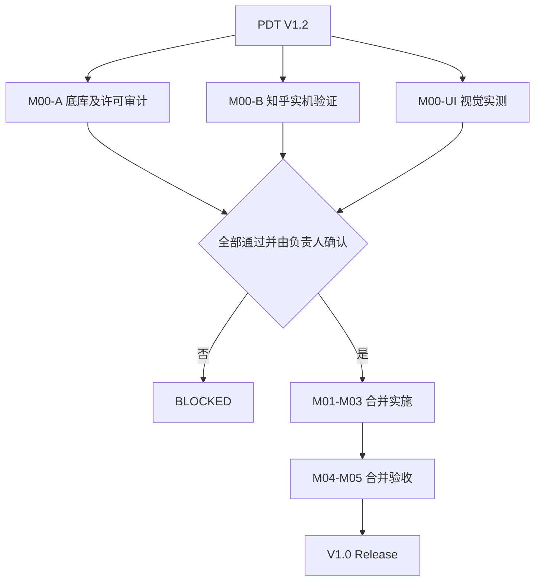

# Zhihu Doc Reader — 产品定义文档（PDT V1.2）

## 00. 文档控制

| 项目 | 定义 |
|---|---|
| 产品名称 | Zhihu Doc Reader（知乎文档阅读助手） |
| 文档版本 | PDT V1.2（V1.1 正文与 V1.2 视觉规范整合版） |
| 目标产品版本 | V1.0 |
| 更新日期 | 2026-11-26 |
| 项目性质 | 个人开源项目 |
| 开发状态 | M00 READY；M01–M05 LOCKED |
| 运行平台 | Chrome / Microsoft Edge |
| 运行环境 | Tampermonkey 5.3+ |
| 开发语言 | JavaScript、CSS、HTML |
| 指定底库 | connectedGraph/zhihu-immersive-reader v5.1.6 |
| 底库许可 | MIT（M00 核验） |

本文件合并产品定义、功能需求、基础技术设计、视觉规范、开发约束及验收标准。无需另写 PRD 或 TDD。本文件为开发任务基线，不代表已完成源码审计、依赖验证、浏览器实测或视觉基线冻结。

## 01. 产品背景

知乎原生网页包含大量社区交互组件、推荐模块及复杂的信息展示结构。本项目通过 Tampermonkey 用户脚本，将知乎网页转换为简洁的在线文档式阅读空间，保留用户正常访问知乎内容的能力，并支持连续阅读、搜索、收藏和历史记录。

视觉设计参考飞书云文档的布局、排版、色彩、间距和基础交互反馈，而非学习飞书的产品功能或底层实现。不接入飞书 API，不复刻协作、权限或编辑功能，不冒用飞书品牌、身份、Logo 或域名。

## 02. 产品定位

一款轻量级、本地运行、无需独立服务器及 AI API 的知乎文档阅读工具，面向个人桌面浏览器用户。

核心价值：简洁的文档式阅读体验、降低视觉干扰、保留热榜及原生推荐和搜索、支持连续阅读、降低部署和维护成本。

正式交付物为可独立安装的 `.user.js` 文件；使用者无需安装 Python、配置 AI 模型或运行本地服务器。

## 03. 产品设计原则

1. 轻量化：不引入不必要的框架及复杂工程架构。
2. 本地优先：设置、收藏和历史仅存于浏览器。
3. 原生复用：优先使用知乎正常呈现的页面内容。
4. 最小权限：仅申请当前功能必要权限。
5. 可逆设计：关闭文档模式后可恢复原生页面。
6. 模块独立：数据提取与渲染分离。
7. 合规访问：不绕过登录、付费、验证码及平台访问控制。
8. 证据优先：未实际验证的功能不得标记通过。
9. 范围锁定：V1.0 不提前开发其他平台适配能力。

## 04. 底库锁定及复用策略

### 4.1 唯一指定底库

- Repository: `connectedGraph/zhihu-immersive-reader`
- URL: https://github.com/connectedGraph/zhihu-immersive-reader
- Version: v5.1.6
- License: MIT（待 M00 核验并保留原始许可证及版权声明）

M00 必须核对源码、发布产物、Git Commit SHA、发布文件 SHA-256、许可证、实际脚本权限、外部网络请求清单、构建入口及输出路径。不得以未锁定的 main 分支实施；如无法建立指定版本源码和发布产物之间的可靠对应关系，标记 BLOCKED，不得自行换库。

### 4.2 禁用底库

禁止使用 `Kyouichirou/Zhihu_Optimizer` 作为本项目开发基础。此前审计将其列为已归档且兼容性不可靠的项目。

### 4.3 保留及调整

| 上游能力 | 处理 |
|---|---|
| 沉浸阅读、页面识别 | 保留并重构 |
| 首页推荐、关注动态 | 保留可用逻辑并调整 |
| 问答、专栏阅读 | 保留 |
| 图片、富文本 | 保留 |
| 主题配置 | 简化 |
| 内容翻页 | 保留并调整 |
| 模式退出及恢复 | 保留 |
| 本地待读机制 | 审计后复用 |

### 4.4 强制剥离

剥离 AI 翻译、划词 AI 翻译、AI 阅读笔记、Wiki 学习卡片库、LLM 内容结构化、Embedding、AI API 配置、API Key 管理、外部模型请求、后台批量全文采集、Wiki 缓存及向量数据库、自动跨平台分享及内容导出。

剥离必须覆盖源码、构建产物、权限、存储及网络调用，不得只隐藏 UI。测试原始底库时不得配置 AI 密钥或主动触发 AI 功能；测试前检查相关网络行为。

## 05. 功能需求

| ID | 功能 | 优先级 |
|---|---|---|
| F01 | 文档式阅读界面 | P0 |
| F02 | 知乎热榜 | P0 |
| F03 | 个性化推荐 | P0 |
| F04 | 关键词搜索 | P0 |
| F05 | 文章及回答全文阅读（限有权访问的内容） | P0 |
| F06 | 上一篇、下一篇及回答切换 | P0 |
| F07 | 图片及富文本渲染 | P0 |
| F08 | 原生模式与文档模式切换 | P0 |
| F09 | 本地阅读历史 | P1 |
| F10 | 本地收藏 | P1 |
| F11 | 字号、行距、宽度及主题 | P1 |
| F12 | 阅读快捷键 | P1 |
| F13 | 关注动态 | P1 |
| F14 | 评论阅读 | P2 |

V1.0 正式发布必须完成 P0、P1；P2 不作为发布条件。

## 06. 数据源及降级策略

### 6.1 总体原则

优先使用原生页面已加载 DOM。不新增开放平台 Access Secret 或第三方付费数据服务；不读取、提取或导出 Cookie；仅在当前知乎会话正常访问权限内获取内容；不绕过访问限制，不伪造实时内容。

### 6.2 数据源矩阵

| 功能 | 主数据源 | 加载方式 | 失败降级 |
|---|---|---|---|
| F01 | 当前页面 DOM | CSS / DOM 重构 | 恢复原生页面 |
| F02 | `www.zhihu.com/hot` | 提取原生热榜已加载内容 | 原生热榜页 |
| F03 | `www.zhihu.com/` | 原生推荐流 DOM、正常加载机制 | 原生推荐页 |
| F04 | `www.zhihu.com/search` | 原生搜索页面重排 | 原生搜索页 |
| F05 问答 | 经 M00 验证的上游 Answer Feed Adapter | 每批最多 6 条，沿有效 `paging.next` 加载 | 已渲染回答 DOM |
| F05 专栏 | `zhuanlan.zhihu.com/p/*` 正文 DOM | 提取可正常访问的正文 | 原生文章页 |
| F06 | 当前有效内容队列 | 本地索引及按需加载 | 禁用不可用方向 |
| F07 | 原文 HTML、图片地址 | 安全清洗后渲染 | 文本及原文链接 |
| F08 | 本地设置及页面状态 | 挂载、卸载、样式恢复 | 刷新原生页面 |
| F09 | GM Storage | 本地读写 | 关闭历史并提示 |
| F10 | GM Storage | 本地读写 | 保留阅读并提示 |
| F11 | GM Storage | 本地读写 | 恢复默认设置 |
| F12 | 浏览器键盘事件 | 本地处理 | 界面按钮 |
| F13 | `/follow` 原生页面 | 提取已加载内容 | 原生关注页 |
| F14 | 可访问原生评论 | P2，暂不实施 | 原文链接 |

### 6.3 热榜

不使用知乎开放平台热榜 API，不新增非公开热榜接口。展示原生排名、标题、链接及存在时的摘要、热度、缩略图。缺失字段省略，不推算或填造。

### 6.4 推荐

复用原生推荐流。不自建推荐算法，不主动分析用户偏好，不批量后台抓取，不默认保留上游多批预取。继续阅读时复用正常页面加载机制。

### 6.5 搜索

关键词提交后进入知乎原生搜索路由，重排已加载结果。区分登录墙、无结果及网络错误；不承诺无限翻页或固定结果数量。

### 6.6 问答全文

M00 验证后允许复用上游 `/api/v4/questions/{question_id}/feeds`。这是可能变化的网页内部接口，不是稳定开放 API。

- 每批最多 6 条，按用户阅读需求加载，不并发批量采集。
- 不新增签名破解，不绕过原生访问控制。
- 下一页地址须验证知乎域名及请求范围。
- 401、403、429、验证码或权限限制时停止相关请求。
- 失败后仅使用当前页面已加载内容。
- 若 M00 无法验证其可用性和访问边界，采用 DOM-only 模式，记录降级并由负责人确认是否放行。

### 6.7 数据标准化

字段：`contentId`、`contentType`、`title`、`author`、`sourceUrl`、`excerpt`、`contentHtml`、`publishedAt`、`fetchedAt`。缺失值允许为空，不得虚构。

## 07. 用户界面

| 区域 | 内容 |
|---|---|
| 顶部导航 | 产品标识、搜索、阅读设置、模式切换、打开原文 |
| 左侧导航 | 热榜、推荐、关注、搜索结果、收藏、历史、当前阅读队列 |
| 中央正文 | 标题、作者、发布时间、正文、富文本、翻页、收藏、原文链接 |
| 右侧辅助区 | 自动生成章节目录、阅读进度、当前问题回答列表；可折叠 |

未完成 P1 功能不得伪装为可用入口。不开发额外相关问题推荐系统。右侧目录是本项目目标布局，不代表飞书真实编辑器必然具有同样布局。

视觉规范以第 20 节及 M00-UI 冻结后的 UI-SPEC 为准。默认使用简洁文档式工具栏、浅色背景、侧边目录、居中正文、清晰标题层级；支持浅色及深色主题，保留明确内容来源标识。

首次安装默认保留知乎原生页面，由用户主动开启文档模式；开启状态可持久化。退出时清理插件注入 UI、样式、事件监听及遮罩，必要时刷新恢复原生页面。不使用飞书 Logo、品牌名称或虚假登录界面。

## 08. 本地存储

统一使用同一 Tampermonkey 用户脚本的 GM Storage，覆盖 `https://www.zhihu.com/*` 和 `https://zhuanlan.zhihu.com/*`，不为两个域名分别建立数据库。

存储键：`zdr:v1:settings`、`zdr:v1:history`、`zdr:v1:bookmarks`、`zdr:v1:schemaVersion`。不直接复用上游 AI、Wiki 或旧版缓存键。

| 类型 | 默认上限 | 超限处理 |
|---|---:|---|
| 历史 | 500 条 | 删除最早记录 |
| 收藏 | 1,000 条 | 提示已满，不静默删除 |
| 设置 | 1 份 | 覆盖更新 |
| 临时阅读队列 | 100 条 | 释放旧队列 |

历史保存内容 ID、标题、来源链接、最近阅读时间、进度；收藏保存内容 ID、标题、作者、原文链接、收藏时间，以内容类型与 ID 组合去重。不长期保存完整正文及图片二进制，不自动同步到知乎账号收藏夹。

验证主站与专栏互相可见收藏、跨域刷新设置一致、多标签页读取更新数据、浏览器重启后记录存在。不要求跨浏览器或跨设备云同步。

## 09. 技术架构

| 组件 | 方案 |
|---|---|
| 运行环境 | Tampermonkey |
| 核心逻辑 | 原生 JavaScript ES6+ |
| 样式 | CSS3、Design Tokens |
| 页面识别 | URL Router |
| 动态监听页面 | MutationObserver |
| 内容获取 | DOM + 经验证的上游 Feed Adapter |
| 存储 | GM Storage |
| 富文本 | 安全 HTML 清洗 |
| 构建 | 上游 Node.js 构建脚本 |
| 测试 | Node.js / Playwright |
| 版本管理及 CI | GitHub / GitHub Actions |

模块：Core Controller（生命周期）、Page Router（路由）、Content Adapter（提取与标准化）、Document Renderer（渲染）、Navigation Manager（队列与翻页）、Storage Manager（存储）、Settings Manager（设置）、Error Handler（异常恢复）。不提前引入复杂扩展架构。

构建：`node build.js`，输出 `dist/bundle.user.js`。M00 验证实际构建入口及路径。源码以 `src/` 为维护来源，不只改 dist；CI 验证可构建。

## 10. 非功能性需求

**性能：** 不定时后台采集，不重复注册 MutationObserver，不重复挂载组件；退出释放监听及临时对象；失败不无限重试。

**安全：** 不收集用户名、密码、Cookie、Token、API Key；不向第三方传输正文及阅读数据；不执行正文脚本；清洗危险 HTML 属性及链接协议；不保留未审计 AI 请求；不申请全网站权限；不使用未锁定、未审计的远程可执行依赖；不绕过知乎或企业设备访问限制。

**维护：** 数据提取与样式分离，选择器集中管理，接口失败有明确降级路径，异常可恢复，页面改版优先局部修复 Adapter。

## 11. 非目标范围

不开发飞书机器人、飞书 API、独立服务器、AI 分析翻译、LLM/Embedding、独立账号、云同步、自动发帖评论、付费解锁、批量采集、企业级权限、网络访问记录隐藏、绕过企业浏览器管理策略、其他平台适配、Safari、移动端浏览器及手机 App。

## 12. 开发路线及门禁

| 阶段 | 任务 | 状态 |
|---|---|---|
| M00-A | 底库版本、源码、许可及权限审计 | NOT RUN |
| M00-B | 知乎真实浏览器及数据源验证 | NOT RUN |
| M00-UI | 视觉参考实测及设计基线 | NOT RUN |
| M00 Gate | 三项通过且负责人确认 | READY（尚未通过） |
| M01 | 基础工程及 AI 功能剥离 | LOCKED |
| M02 | 文档式界面及正文重构 | LOCKED |
| M03 | 热榜、推荐、搜索及导航 | LOCKED |
| M04 | 收藏、历史及阅读设置 | LOCKED |
| M05 | 测试、兼容性及发布 | LOCKED |

### 12.1 M00 独立验证

M00 不得与 M01–M03 合并。仅执行：指定版本锁定、许可核查、权限/依赖/网络审计、原始 v5.1.6 安装与构建、个人电脑 Chrome/Edge 实测首页/关注/问答/专栏、Feed 与降级验证、原生热榜及搜索可访问性探查、环境和日期记录、生成 `docs/M00-VALIDATION.md`，以及第 21 节视觉验证。不提前实施正式业务功能。

### 12.2 M00 Gate

源码和版本锁定、MIT 核验、原始构建、两浏览器安装、四类上游页面实测、热榜搜索数据路径、权限网络风险审查、异常降级证据、M00-UI 验收均需完成。Feed 不可用但 DOM-only 满足阅读闭环时，记录并由负责人批准降级，不伪装为接口通过。

状态采用 PASS / BLOCKED / NOT RUN；三个子任务通过且负责人确认后 M00 才可 PASS。

### 12.3 M01–M03 合并实施

M00 通过后初始化项目，剥离 AI/Wiki，完成文档界面、P0 阅读闭环、原生恢复与 P0 功能检查。

### 12.4 M04–M05 合并验收

完成 P1、跨域存储、兼容性、异常安全测试、视觉对照、GitHub CI 后发布 V1.0。

## 13. 实机测试环境

个人电脑；Chrome Stable、Edge Stable、Tampermonkey 5.3+；按对应浏览器要求启用 Allow User Scripts 或适用的开发者模式，不绕过组织策略。

记录实际 OS、Chrome/Edge 完整版本、Tampermonkey 版本、脚本版本、源码 SHA、日期、登录状态；不得预填未经验证的实际版本。

| ID | 页面 | URL |
|---|---|---|
| URL01 | 首页 | https://www.zhihu.com/ |
| URL02 | 关注 | https://www.zhihu.com/follow |
| URL03 | 热榜 | https://www.zhihu.com/hot |
| URL04 | 问答 | https://www.zhihu.com/question/19550225 |
| URL05 | 专栏 | https://zhuanlan.zhihu.com/p/352503954 |
| URL06 | 搜索 | https://www.zhihu.com/search?type=content&q=阅读 |

问答和专栏样本沿用 V1.1，当前实际可访问性尚未验证；若删除、受限或不可用，记录原因与替代 URL，不静默更换。

## 14. 可执行验收标准

| ID | 测试 | PASS 条件 |
|---|---|---|
| AT01 | 安装 | Chrome / Edge 均可安装发布脚本 |
| AT02 | 页面注入 | 每个支持页面仅有一个插件根组件 |
| AT03 | 推荐 | 至少一条原生可访问内容可打开阅读 |
| AT04 | 热榜 | 当前可见条目标题与顺序同原生页 |
| AT05 | 搜索 | 关键词正确提交；有结果时至少一条可打开 |
| AT06 | 空搜索 | 明确空状态，无虚假内容 |
| AT07 | 问答 | 至少一条可访问回答完整展示 |
| AT08 | 回答切换 | 有多个回答时连续切换三次无重复错误 |
| AT09 | 专栏 | 标题、作者、可访问正文与原文一致 |
| AT10 | 富文本 | 标题、列表、引用、链接、可访问图片正确显示 |
| AT11 | 退出 | 原生页面恢复，插件根组件移除 |
| AT12 | 连续切换 | 进入、退出五次无重复组件 |
| AT13 | 历史 | 刷新及浏览器重启后保留 |
| AT14 | 收藏 | 收藏、取消、重复收藏处理正确 |
| AT15 | 跨域 | 主站及专栏收藏和设置一致 |
| AT16 | 设置 | 字号、行距、主题刷新后保留 |
| AT17 | 快捷键 | 文档模式内有效，不干扰输入 |
| AT18 | 关注 | 登录后展示可访问动态 |
| AT19 | 路由 | 页面切换正确更新，无重复挂载 |
| AT20 | Feed 失败 | 请求失败后进入 DOM 降级 |
| AT21 | 访问限制 | 401/403/429 或验证码时停止相关请求 |
| AT22 | 未登录 | 公开内容可读，受限内容遵循原生登录要求 |
| AT23 | AI 剥离 | 发布脚本无可执行 LLM/Embedding 调用路径 |
| AT24 | 网络安全 | 无插件主动发起的未授权第三方数据请求 |
| AT25 | HTML 安全 | 恶意脚本及危险事件属性不执行 |
| AT26 | 构建 | `node build.js` 正常退出并生成发布文件 |
| AT27 | 发布产物 | 单文件可直接安装 |
| AT28 | 文档 | 英中安装说明、许可证、变更记录齐全 |

### 14.1 登录状态矩阵

| 功能 | 已登录 | 未登录 |
|---|---|---|
| 推荐 | 当前账号可访问推荐 | 公开推荐或原生登录提示 |
| 关注 | 可访问关注动态 | 原生登录提示 |
| 热榜 | 可访问内容 | 公开内容或原生限制提示 |
| 搜索 | 原生搜索能力 | 遵循原生搜索限制 |
| 全文 | 有权访问内容 | 仅公开可访问内容 |
| 收藏、历史 | 可用 | 对已访问内容可用 |

### 14.2 异常测试

覆盖断网、Feed 失败、正文缺失、图片失败、空搜索、登录限制、付费限制、存储损坏、不支持路由。不伪造内容，不无限重试。若最终批准 DOM-only 方案，AT20/21 按实际启用路径验证，并记录适用性，不伪造 Feed 测试结果。

### 14.3 证据要求

记录测试 ID、浏览器、URL、登录状态、预期、实际、PASS/FAIL/BLOCKED/NOT RUN、截图或必要日志。未执行不得标记 PASS；CI 不能替代真实知乎实测。视觉验收同时依据冻结后的 UI-SPEC 与参考截图，记录实际差异。

## 15. GitHub 项目规范

仓库建议名称：`zhihu-doc-reader`。

```text
zhihu-doc-reader/
├── README.md
├── README_CN.md
├── LICENSE
├── CHANGELOG.md
├── build.js
├── docs/
│   ├── PDT-V1.2.md
│   ├── M00-VALIDATION.md
│   ├── ACCEPTANCE.md
│   └── design/
│       ├── UI-SPEC.md
│       └── references/
│           ├── 01-document-layout.png
│           ├── 02-typography.png
│           └── 03-interaction.png
├── src/
│   └── styles/
│       ├── tokens.css
│       ├── layout.css
│       ├── typography.css
│       └── components.css
├── tests/
├── dist/
│   └── bundle.user.js
├── screenshots/
└── .github/workflows/ci.yml
```

默认英文 README，独立中文版；代码、变量、注释使用英文，UI 默认简体中文。保留上游 MIT 许可证和版权声明，注明上游及锁定版本，记录重大修改；不得提前发布未测试的 V1.0。

## 16. 工时及预算

M00 验证原估半天，新增视觉实测的耗时取决于个人测试文档和测量条件；首次可用版本原估 3–6 小时；完整验收取决于页面适配；普通页面改版修复原估 0.5–2 小时。均为未经实测的量级参考，不是承诺；重大改版可能显著增加成本。不再用 VOC M06 作为正式计量单位。AI API 与独立服务器预算为 0。

## 17. 产品成功标准

可独立安装、无后端和 AI API 依赖、核心阅读稳定、原生模式可恢复、个人数据本地保存、无未授权数据传输、具备真实浏览器测试证据、维护成本可控。不以 Star、用户数量、商业收入衡量成功。

## 18. Codex 执行约束

先执行 M00；不自行替换或升级底库，不提前开发 M01–M05，不自行增加 AI、后端或新知乎接口，不伪造响应或测试证据；访问受限时停止请求，范围变化须负责人确认；M00 未通过不得进入正式开发。

## 19. 版本关系

- V1.0：初始产品定义。
- V1.1：底库锁定、剥离清单、数据源矩阵、存储、构建、独立 M00、28 项验收、范围及估算修正。
- V1.2：在 V1.1 基础上增加视觉逆向分析、参考证据分级、参考值与目标值区分、M00-UI、UI-SPEC、CSS Design Tokens、三档正文宽度参考及联合准入门禁。其余产品功能不变。

## 20. 视觉设计参考规范（V1.2）

### 20.1 目标与边界

仅学习飞书真实云文档编辑器的视觉语言：顶部栏、侧栏、正文与目录的空间分配；标题、正文、列表、引用、代码块排版；配色、间距、边框；折叠、Hover、选中、滚动及响应式反馈。上一篇/下一篇属于本项目自定义交互。

不研究飞书 API、业务架构、实时编辑、协作、权限等非视觉功能。不要求像素级复刻，不使用飞书官方 Logo、品牌名称及专有资源，不复制专有源码。

### 20.2 参考资料等级

| 等级 | 来源 | 用途 | 实施依据 |
|---|---|---|---|
| S | 真实个人飞书文档编辑器 F12 Computed Style | 精确 CSS 测量 | 可以 |
| A | 真实编辑器截图及交互观察/录屏 | 布局、交互 | 可以 |
| B | 官方帮助及教程 | 理解布局规则 | 辅助 |
| C | 产品宣传页 | 大致风格 | 不可单独作为基线 |
| D | AI 原型及建议参数 | 设计探索 | 不可作为实测 |

公开参考入口（沿用前文）：https://docs.feishu.cn/docs （宣传页）；https://www.feishu.cn/hc/zh-CN/articles/909135942944 （页面宽度）；https://www.feishu.cn/content/article/7572026952902230020 （教程）。真实 F12 测量必须在个人测试文档中执行，不以宣传页代替。

每项记录 Reference Value（实测）、Target Value（产品目标）、Evidence（证据）、Rationale（不同于实测时的理由）。未测标 UNVERIFIED。

### 20.3 测量环境

记录 OS、浏览器完整版本、视口宽高、浏览器缩放、系统显示缩放、devicePixelRatio、文档宽度模式、界面语言、日期。建议 100% 浏览器缩放并统一视口；必要时记录其他视口下响应式变化。

### 20.4 测量范围

- Layout：顶部栏高度、左侧导航、右侧辅助区（如存在）、默认/较宽/全宽正文布局、正文内边距、侧栏折叠。
- Typography：主标题、H1/H2/H3、正文字体族/字号/字重/行高/段距、引用、有序无序列表、行内代码/代码块、图片/图注、超链接。
- Color and Spacing：页面及侧栏背景、正文、辅助文字、主色、选中、边框、Hover、圆角、内外边距、阴影（如有）。
- Interaction：侧栏和目录折叠、Hover、选中、锚点跳转、滚动、窗口宽度变化。

### 20.5 正文宽度及初始参数表

以飞书默认文档宽度为首选参考模式；较宽及全宽辅助参考。最终宽度根据实测和知乎阅读需要确定。800px 只是初始建议值，不是飞书官方实测值。

**下表全部为 UNVERIFIED 草稿，不得作为正式实施基线。**

| 参数 | 初始建议值 | Reference Value | Target Value |
|---|---|---|---|
| 顶部栏高度 | 56px | 待测 | 待定 |
| 左侧栏宽度 | 240px | 待测 | 待定 |
| 右侧目录宽度 | 200px | 待测 | 待定 |
| 默认正文宽度 | 800px | 待测 | 待定 |
| 较宽正文宽度 | 未定义 | 待测 | 待定 |
| 全宽布局 | 未定义 | 待测 | 待定 |
| 文档标题 | 32px | 待测 | 待定 |
| H1 | 24px | 待测 | 待定 |
| H2 | 20px | 待测 | 待定 |
| H3 | 未定义 | 待测 | 待定 |
| 正文 | 16px | 待测 | 待定 |
| 正文行高 | 1.75 | 待测 | 待定 |
| 段落间距 | 12px | 待测 | 待定 |
| 主色 | #3370FF | 待测 | 待定 |
| 背景 | #FFFFFF | 待测 | 待定 |
| 正文颜色 | #1F2329 | 待测 | 待定 |
| 辅助文字 | #646A73 | 待测 | 待定 |
| Hover | #F2F3F5 | 待测 | 待定 |
| 边框 | #DEE0E3 | 待测 | 待定 |
| 圆角 | 6px | 待测 | 待定 |

拟采用变量命名：`--zdr-header-height`、`--zdr-sidebar-width`、`--zdr-outline-width`、`--zdr-content-width`、`--zdr-font-size`、`--zdr-line-height`、`--zdr-title-size`、`--zdr-h1-size`、`--zdr-h2-size`、`--zdr-primary`、`--zdr-background`、`--zdr-text`、`--zdr-text-secondary`、`--zdr-border`、`--zdr-hover`、`--zdr-radius`、`--zdr-paragraph-gap`。正式 tokens.css 仅填入已经确认的 Target Value。

### 20.6 视觉适配

允许根据知乎内容结构调整设计。热榜、推荐、回答切换、收藏、历史属于产品自身功能，应采用统一视觉语言自主设计，不虚构飞书存在的布局或功能。风格参考，不做像素级复刻。

## 21. M00-UI 独立视觉验证任务

### 21.1 输入与测试文档

个人飞书测试文档（无企业内部信息）、Chrome 或 Edge 开发者工具、本文件初始参数表。测试文档含主标题、H1/H2/H3、多段正文、有序无序列表、引用、超链接、代码块、图片和自动生成目录。

### 21.2 执行步骤

1. 观察真实文档编辑器默认布局。
2. 记录默认、较宽、全宽模式。
3. 使用 Computed Style 提取实际 CSS 参数。
4. 观察折叠、Hover、选中及滚动状态。
5. 保存三张代表性截图。
6. 建立参考实测值与目标值对照表（含证据与调整理由）。
7. 确定产品布局及视觉变量。
8. 生成 UI-SPEC.md。
9. 生成 tokens.css。
10. 提交负责人确认。

### 21.3 交付物

- `docs/design/references/01-document-layout.png`：真实完整文档布局。
- `docs/design/references/02-typography.png`：真实标题、正文及富文本。
- `docs/design/references/03-interaction.png`：真实导航/目录交互状态。
- `docs/design/UI-SPEC.md`：环境、证据、实测值、目标值、调整理由。
- `src/styles/tokens.css`：已确认目标值。

截图仅使用无敏感信息的个人文档，不包含公司机密。当前未提供实测截图或 CSS 测量记录，因此交付物尚未生成。

### 21.4 Gate

PASS 须满足：三张真实截图齐全、环境完整、核心布局/排版实测、颜色及交互已观察、正文宽度模式已确定、参考与目标值区分、UI-SPEC 与 tokens.css 一致、负责人确认。未完成真实测量不得 PASS。

### 21.5 范围限制

M00-UI 不实施正式知乎页面重构，不开发飞书 API、文档编辑器、权限、实时协作及后端，不获取登录凭据，不复制专有源码和资源。

## 22. 联合准入及当前状态



| 项目 | 当前状态 |
|---|---|
| PDT V1.2 | READY |
| M00-A | NOT RUN |
| M00-B | NOT RUN |
| M00-UI | NOT RUN |
| 视觉参数冻结 | LOCKED |
| M01–M05 | LOCKED |

## 23. 版本变更记录

V1.2：新增视觉逆向分析、证据分级、参考/目标值、M00-UI、UI-SPEC、视觉参考目录、CSS Design Tokens、三档正文宽度参考及联合准入条件。V1.1：底库锁定、数据源矩阵、安全、跨域存储、工程验收。V1.0：初始定义。

## 附录 A. 后续依赖建议（尚未冻结，不构成新增实施授权）

以下来自 V1.2 后的依赖讨论，供 M00 审计；不代表已核验版本或兼容性，不改变 V1.2 的功能范围。

| 项目 | 角色 | 处理 |
|---|---|---|
| [zhihu-immersive-reader](https://github.com/connectedGraph/zhihu-immersive-reader) | 核心底库 | 指定 v5.1.6，M00 锁定及审计 |
| [Semi Design](https://github.com/DouyinFE/semi-design) | 飞书主题视觉参考 | 仅参考，不进入运行依赖，不代替编辑器实测 |
| [DOMPurify](https://github.com/cure53/DOMPurify) | HTML 安全清洗 | 建议在 M00 核验后锁定版本、构建时打包 |
| [Playwright](https://github.com/microsoft/playwright) | 自动化测试、截图、CSS 测量 | 开发依赖 |
| [Lucide](https://github.com/lucide-icons/lucide) | 图标 | 可选，按需打包 SVG |
| Node.js | 构建环境 | 核验上游构建要求 |
| Tampermonkey | 用户运行环境 | 5.3+，实机记录版本 |

不引入 React/Vue、Axios、独立数据库、VPS、AI 模型等非必要依赖。实际依赖须审计许可、版本、权限、网络行为和构建兼容性，禁止运行时动态加载未经审计的 CDN 代码。
